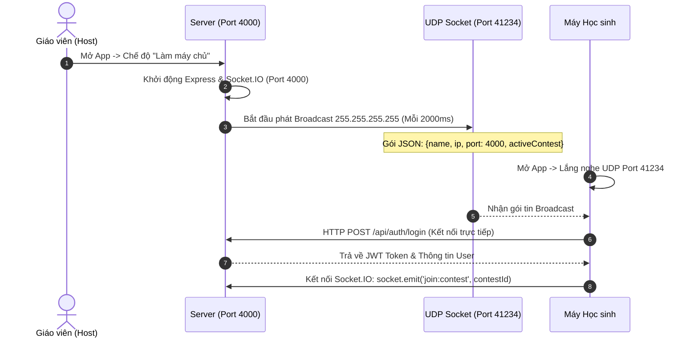
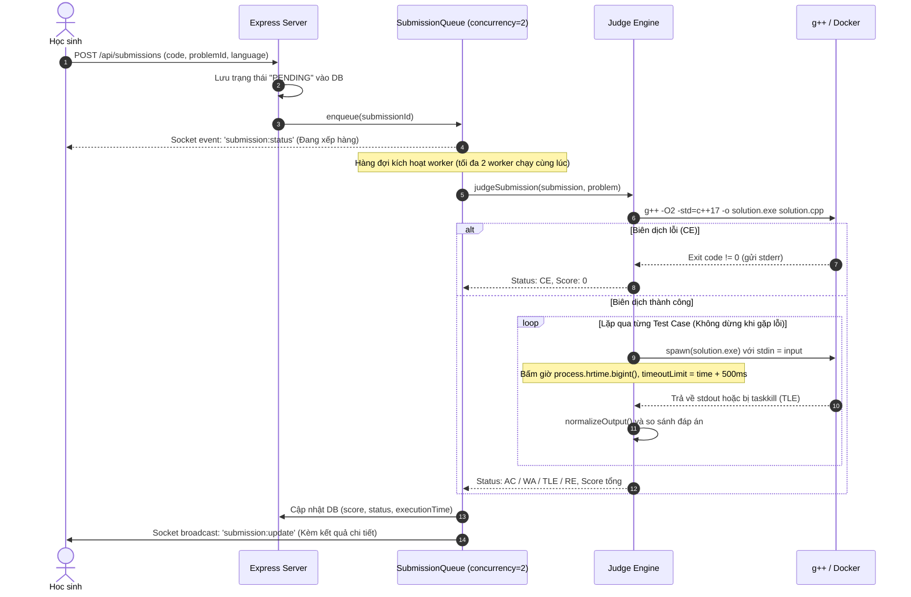

# PROJECT DOSSIER: HỒ SƠ KỸ THUẬT DỰ ÁN CHAUCAOJUDGE

> **Tài liệu bàn giao kỹ thuật phục vụ viết Báo cáo Khoa học Kỹ thuật (KHKT) cấp Thành phố**  
> **Nguyên tắc biên soạn:** Trung thực 100%, chỉ dựa trên mã nguồn, cấu hình, nhật ký Git và thực nghiệm đo lường trực tiếp trên hệ thống.  
> **Ngày lập hồ sơ:** 09/10/2026.

---

## MỤC LỤC

1. [Tổng quan hệ thống](#1-tổng-quan-hệ-thống)
2. [Công nghệ và phiên bản](#2-công-nghệ-và-phiên-bản)
3. [Cấu trúc dự án và quy mô mã nguồn](#3-cấu-trúc-dự-án-và-quy-mô-mã-nguồn)
4. [Kiến trúc và luồng hoạt động](#4-kiến-trúc-và-luồng-hoạt-động)
5. [Bộ chấm — Chi tiết kỹ thuật](#5-bộ-chấm--chi-tiết-kỹ-thuật)
6. [Cơ chế phát hiện và kết nối mạng nội bộ (LAN)](#6-cơ-chế-phát-hiện-và-kết-nối-mạng-nội-bộ-lan)
7. [Lưu trữ dữ liệu và an toàn thông tin](#7-lưu-trữ-dữ-liệu-và-an-toàn-thông-tin)
8. [Hệ thống xếp hạng Elo Rating](#8-hệ-thống-xếp-hạng-elo-rating)
9. [Đấu trường đối kháng Arena 1v1](#9-đấu-trường-đối-kháng-arena-1v1)
10. [Cơ chế Gamification (Thành tựu, Điểm thưởng, Chuỗi ngày, Lộ trình)](#10-cơ-chế-gamification)
11. [Chức năng dành cho Giáo viên](#11-chức-năng-dành-cho-giáo-viên)
12. [Đóng gói phân phối và Tự động cập nhật](#12-đóng-gói-phân-phối-và-tự-động-cập-nhật)
13. [Lịch sử phát triển và Nhật ký sửa lỗi](#13-lịch-sử-phát-triển-và-nhật-ký-sửa-lỗi)
14. [Số liệu thực nghiệm từ cơ sở dữ liệu](#14-số-liệu-thực-nghiệm-từ-cơ-sở-dữ-liệu)
15. [Bộ kiểm thử tự động có sẵn](#15-bộ-kiểm-thử-tự-động-có-sẵn)
16. [Kết quả đo kiểm năng năng lực và Benchmark](#16-kết-quả-đo-kiểm-năng-lực-và-benchmark)
17. [Giới hạn kỹ thuật và Các tính năng CHƯA LÀM](#17-giới-hạn-kỹ-thuật-và-các-tính-năng-chưa-làm)
18. [Chi phí vận hành và Mô hình triển khai](#18-chi-phí-vận-hành-và-mô-hình-triển-khai)
19. [Danh mục màn hình minh họa báo cáo](#19-danh-mục-màn-hình-minh-họa-báo-cáo)
20. [Mục "Điều tôi không chắc" và Câu hỏi cho tác giả](#20-mục-điều-tôi-không-chắc-và-câu-hỏi-cho-tác-giả)

---

## 1. TỔNG QUAN HỆ THỐNG

- **Tên dự án:** ChauCaoJudge (trong mã nguồn Electron/Package đặt tên là `chaucaojudge`, tên thư mục làm việc: `Manager_Student`).
- **Phiên bản hiện tại:** `1.6.5` (xác định tại `package.json:3`).
- **Mục đích thực tế trong code:** Phần mềm hỗ trợ tổ chức thi lập trình, chấm điểm tự động và quản lý học sinh theo mạng nội bộ (LAN) hoặc qua Internet, giải quyết bài toán chấm bài trực tiếp theo thời gian thực thay cho phương thức nộp bài qua USB truyền thống (phải đợi giáo viên gom bài và chấm offline sau 1–2 giờ). Đồng thời tích hợp tính năng luyện tập cá nhân, đấu trường 1v1 đối kháng và bảng xếp hạng Elo.
- **Các vai trò người dùng (Roles):**
  - `host` (Giáo viên / Quản trị viên): Khởi tạo máy chủ, quản lý ngân hàng đề, tạo kỳ thi, giám sát trực tiếp màn hình Live Monitor, in thẻ dự thi, xuất báo cáo điểm số ra file CSV/PDF.
  - `user` (Học sinh): Kết nối vào phòng thi, làm bài trên Monaco Editor, nộp bài, xem kết quả chi tiết từng test case, tham gia đấu trường Arena 1v1, tích điểm đổi quà và xem lộ trình học tập.
  - *(Ghi chú: Trong giao diện và tài liệu có dùng thuật ngữ Teacher/Student, nhưng trong schema cơ sở dữ liệu `server/db.cjs:79` chỉ lưu 2 giá trị phân quyền là `host` và `user`)*.
- **Các chế độ chạy:**
  - **Chế độ LAN (Mặc định):** Máy giáo viên đóng vai trò Server, tự động phát gói tin UDP Broadcast; máy học sinh tự quét và kết nối vào IP máy giáo viên trên cổng 4000 mà không cần cấu hình thủ công.
  - **Chế độ Internet:** Chạy qua Cloudflare Tunnel (`cloudflared`) hoặc DuckDNS Dynamic DNS (hỗ trợ qua script `scripts/tunnel.cjs` và `scripts/update-duckdns.ps1`).

---

## 2. CÔNG NGHỆ VÀ PHIÊN BẢN

Dữ liệu trích xuất trực tiếp từ file `package.json`:

| Thành phần | Công nghệ / Thư viện | Phiên bản khai báo | Ghi chú từ mã nguồn |
| :--- | :--- | :--- | :--- |
| **Ngôn ngữ chính** | JavaScript (Node.js CJS), TypeScript | ES2020 / TS 5.x | Backend dùng CJS `.cjs`, Frontend dùng TSX `.tsx` |
| **Môi trường Desktop** | Electron | `^31.0.0` | Quản lý vòng đời app, IPC, khay hệ thống |
| **Giao diện (Frontend)** | React | `^18.2.0` | React DOM `^18.2.0`, React Router DOM `^6.22.0` |
| **Trình soạn thảo mã** | `@monaco-editor/react` | `^4.6.0` | Trình biên soạn code C++ trên giao diện học sinh |
| **Giao tiếp Realtime** | Socket.IO | `^4.7.5` | `socket.io` (Server) và `socket.io-client` `^4.7.5` |
| **Máy chủ HTTP** | Express | `^4.18.2` | REST API, xử lý upload đề và tải báo cáo |
| **Bảo mật mật khẩu** | Argon2 | `^0.40.1` | Dùng băm mật khẩu tài khoản trong `server/auth.cjs` |
| **Chữ ký cập nhật** | `tweetnacl` | `^1.0.3` | Ký và xác thực gói cập nhật Ed25519 (`crypto.cjs`) |
| **Styling & Icons** | Tailwind CSS / Lucide-React | `lucide-react: ^0.344.0` | Giao diện Dark/Light mode |
| **Thư viện in ấn/xuất file**| `jspdf`, `xlsx` | `jspdf: ^2.5.1`, `xlsx: ^0.18.5` | In thẻ dự thi và xuất bảng điểm Excel |
| **Cơ sở dữ liệu** | Lowdb / In-memory JSON / pg | `lowdb: ^7.0.1`, `pg: ^8.11.3` | Mặc định lưu JSON; có adapter PostgreSQL tùy chọn |

### Hệ điều hành đã cấu hình đóng gói vs Thực tế đã build:
- **Cấu hình đóng gói (`package.json:60-98`):**
  - **Windows:** NSIS Installer, target `x64` (`ChauCaoJudge_Setup_${version}.exe`).
  - **Linux:** AppImage, deb, pacman, tar.gz.
  - **macOS:** **KHÔNG CÓ TRONG CẤU HÌNH BUILD**. Trong `package.json` mục `build` hoàn toàn không có mục cấu hình `mac` (dù một số tài liệu README có nhắc tới).
- **Hệ điều hành thực sự đã build:** **Windows 64-bit**. Bằng chứng: Thư mục `release/` chứa file cài đặt duy nhất là `release/ChauCaoJudge_Setup_1.6.5.exe` (kích thước 140,093,241 bytes ~ 133.6 MB, build lúc 08/10/2026).

---

## 3. CẤU TRÚC DỰ ÁN VÀ QUY MÔ MÃ NGUỒN

### Cây thư mục (Cấp 2 - 3)
```text
c:\Manager_Student\
├── electron/                   # Mã nguồn tiến trình chính Electron (Main Process)
│   ├── main.cjs                # Khởi tạo cửa sổ, vòng đời app, IPC handlers, khay hệ thống
│   └── preload.cjs             # Cầu nối IPC an toàn (contextBridge) giữa Electron và Renderer
├── server/                     # Backend API & Bộ chấm chạy nền
│   ├── index.cjs               # Khởi tạo Express, HTTP server, tích hợp Socket.IO, định tuyến
│   ├── judge.cjs               # BỘ CHẤM: Biên dịch C++, thực thi tiến trình, so khớp kết quả
│   ├── queue.cjs               # HÀNG ĐỢI: Điều phối nộp bài, giới hạn 2 workers song song
│   ├── db.cjs                  # Lớp truy xuất dữ liệu JSON, thuật toán tính Elo Rating
│   ├── database/               # Module phân lớp database (JSON Adapter, Postgres Adapter)
│   ├── lanDiscovery.cjs        # Quản lý phát/nhận UDP Broadcast tìm kiếm máy chủ LAN
│   ├── arena.cjs               # Logic đấu trường 1v1, hàng đợi ghép cặp, trận đấu với AI Bot
│   ├── auth.cjs                # Đăng ký, đăng nhập, mã hóa mật khẩu Argon2, JWT token
│   ├── achievementsData.cjs    # Danh mục định nghĩa 100 thành tựu (Gamification)
│   └── roadmapData.cjs         # Danh mục định nghĩa 20 chủ đề lộ trình học thuật toán
├── src/                        # Frontend React SPA
│   ├── App.tsx                 # Điều hướng chính (Routing), kiểm tra phiên đăng nhập
│   ├── components/             # Các thành phần UI dùng chung (Thanh điều hướng, Modal, v.v.)
│   ├── views/
│   │   ├── Host/               # Màn hình Giáo viên: Dashboard, Contest, Problems, Monitor, Classes
│   │   └── Student/            # Màn hình Học sinh: ProblemDetail, Arena, Roadmap, Shop, Profile
│   └── lib/                    # Các module tiện ích frontend (socket, audio, rating)
├── scripts/                    # Scripts tự động hóa, build deb, kiểm tra mạng, xuất báo cáo
├── tests/                      # Bộ kiểm thử đơn vị tự động (Judge, DB, Auth, Policy)
├── benchmarks/                 # Script đo lường năng lực và hiệu năng thực tế
├── package.json                # Khai báo phụ thuộc và cấu hình build electron-builder
└── schooljudge_data.json       # Cơ sở dữ liệu mặc định (seed data)
```

### Thống kê dòng mã nguồn (SLOC thực tế):
*Lệnh đo:* PowerShell `Get-ChildItem -Recurse | Get-Content | Measure-Object -Line`

| Phân hệ | Số lượng file | Tổng số dòng mã (Lines) | File trọng tâm lớn nhất |
| :--- | :---: | :---: | :--- |
| **Frontend (`src/`)** | 47 files | **32,752 lines** | `src/views/Host/LiveMonitor.tsx` (1,842 lines) |
| **Backend (`server/`)** | 30 files | **15,593 lines** | `server/index.cjs` (3,521 lines), `judge.cjs` (926 lines) |
| **Electron Main (`electron/`)** | 2 files | **989 lines** | `electron/main.cjs` (952 lines) |
| **Kiểm thử (`tests/`)** | 9 files | **1,640 lines** | `tests/judge.test.cjs` (229 lines), `api-auth.test.cjs` |
| **Scripts bổ trợ (`scripts/`)** | 18 files | **4,422 lines** | Scripts xuất tài liệu và báo cáo |
| **TỔNG CỘNG MÃ NGUỒN** | **106 files** | **55,396 lines** | *(Chưa tính node_modules và file JSON)* |

---

## 4. KIẾN TRÚC VÀ LUỒNG HOẠT ĐỘNG

### (a) Khởi động và Tự động kết nối LAN


### (b) Nộp bài đến Nhận kết quả


### (c) Giám sát trực tiếp (Live Monitor)
- **Cổng & Giao thức:** HTTP Port 4000 & WebSocket qua Socket.IO.
- **Sự kiện Socket.IO chính:**
  - `monitor:status` / `monitor:violation`: Học sinh gửi trạng thái cửa sổ (blur, mất tiêu điểm, mở tab khác).
  - `submission:new` & `submission:update`: Bắn ngay lập tức tới máy Host khi có bài nộp mới hoặc khi chấm xong.
  - `leaderboard:update`: Cập nhật bảng điểm thời gian thực.
  - **Cơ chế giảm tải (Throttling/Debouncing):** Tại `server/index.cjs:1820`, các sự kiện phát sóng bảng điểm được gom cụm và làm dịu (throttle) theo chu kỳ tối thiểu 1000ms để tránh nghẽn mạng khi hàng chục học sinh cùng nộp bài một lúc.

### (d) Trận Arena 1v1 (Ghép cặp đến Phân định thắng thua)
- **Sự kiện Socket.IO:**
  - `arena:join_queue`: Học sinh gửi yêu cầu tìm trận. Server đưa vào danh sách chờ.
  - `arena:match_found`: Khi có 2 học sinh cùng hàng đợi (hoặc hết 10 giây tự ghép với AI Bot `arena:start_bot_match`), Server tạo Match ID và thông báo cả hai.
  - `arena:code_update`: Gửi tiến độ làm bài (độ dài mã nguồn, số ký tự đã gõ) sang đối thủ.
  - `arena:submit`: Nộp bài trong trận.
  - `arena:match_end`: Kết thúc trận đấu, gửi kết quả thắng/thua và điểm Elo cộng/trừ.

---

## 5. BỘ CHẤM — CHI TIẾT KỸ THUẬT

Thông tin được trích xuất trực tiếp từ file [server/judge.cjs](file:///c:/Manager_Student/server/judge.cjs):

1. **Lệnh biên dịch chính xác:**
   - **Chế độ Native C++:** [judge.cjs:332](file:///c:/Manager_Student/server/judge.cjs#L332)
     ```bash
     g++ -O2 -std=c++17 -o solution.exe solution.cpp
     ```
     (Thời gian chờ biên dịch tối đa là 10,000 ms; nếu vượt quá sẽ bị hủy và báo lỗi CE).
   - **Chế độ Docker (Nếu bật):** [judge.cjs:140](file:///c:/Manager_Student/server/judge.cjs#L140)
     Sử dụng image `gcc:13-bookworm`.
2. **Nơi lưu file tạm:**
   - Sử dụng thư mục tạm của hệ điều hành: `path.join(os.tmpdir(), 'judge_' + Date.now() + '_' + randomString)`.
   - Toàn bộ thư mục này bị xóa bằng `fs.rmSync(tempDir, { recursive: true, force: true })` ngay trong khối `finally` sau khi chấm xong.
3. **Cách chạy chương trình và đo đạc:**
   - Chạy tiến trình qua `child_process.spawn(binaryPath, [], { windowsHide: true })`.
   - **Đo thời gian:** Dùng `process.hrtime.bigint()` ghi mốc trước khi `spawn` và ngay khi sự kiện `close` phát sinh. Độ chính xác tới nanosecond, quy đổi ra mili-giây.
   - **Đo bộ nhớ:**
     - **Trên Windows Native: KHÔNG ĐO ĐƯỢC.** Tại [judge.cjs:430](file:///c:/Manager_Student/server/judge.cjs#L430), mã nguồn trả về cứng `memory: 0`. Do đó **HỆ THỐNG NATIVE HOÀN TOÀN KHÔNG BẮT ĐƯỢC LỖI VƯỢT QUÁ BỘ NHỚ (MLE) TRÊN WINDOWS**.
     - **Trên Docker Linux:** Bộ nhớ bị giới hạn trực tiếp bởi cờ Docker run `--memory="256m"`. Nếu vượt quá, container trả về exit code `137` và hệ thống gắn nhãn MLE.
4. **Cách so sánh output với đáp án:**
   - Hàm `normalizeOutput(str)` tại [judge.cjs:24-34](file:///c:/Manager_Student/server/judge.cjs#L24-L34):
     ```javascript
     function normalizeOutput(str) {
       if (!str) return '';
       return str
         .replace(/\r\n/g, '\n')       // Đổi định dạng xuống dòng Windows về Unix
         .replace(/\r/g, '\n')
         .split('\n')
         .map(line => line.trimEnd())  // Cắt bỏ khoảng trắng thừa ở cuối mỗi dòng
         .join('\n')
         .trim();                      // Cắt bỏ dòng trống và khoảng trắng ở đầu/cuối file
     }
     ```
5. **Cách kết thúc tiến trình khi TLE:**
   - **Windows:** Gọi `execSync('taskkill /pid ' + child.pid + ' /t /f')` ([judge.cjs:410](file:///c:/Manager_Student/server/judge.cjs#L410)). Việc gọi taskkill tiêu tốn một khoản overhead khoảng 190ms – 270ms.
   - **Linux:** Gửi tín hiệu `child.kill('SIGKILL')`.
6. **Số bài chấm song song tối đa và Xếp hàng đợi:**
   - Tại [server/queue.cjs:9](file:///c:/Manager_Student/server/queue.cjs#L9): `this.concurrency = 2;` (Cố định 2 bài chấm cùng một lúc).
   - Cơ chế: Mảng FIFO in-memory (`this.queue = []`). Khi có bài mới, đẩy vào mảng (`push`). Khi một worker rảnh, lấy bài đầu tiên ra (`shift`).
7. **Xử lý khi gặp TLE hoặc RE:**
   - **Code thực tế KHÔNG DỪNG (Không ngắt vòng lặp):** Tại [judge.cjs:445](file:///c:/Manager_Student/server/judge.cjs#L445), vòng lặp `for (let i = 0; i < testcases.length; i++)` tiếp tục chạy qua toàn bộ các test case còn lại để ghi nhận bảng điểm chi tiết từng test.
8. **Cách tính điểm một bài:**
   - Tính theo cơ chế tỷ lệ Subtask: Mỗi test case có `scoreEarned = (prob.points / totalTests)`. Điểm bài nộp bằng tổng điểm các test case đạt `AC`.
9. **Mô hình Sandbox và Đánh giá an toàn thực thi:**
   - **Chế độ Native (Mặc định trên Windows của các trường):** **KHÔNG CÓ SANDBOX.**
     - Tiến trình học sinh chạy với đầy đủ quyền hạn của tài khoản Windows đang đăng nhập (thường là quyền Admin của phòng máy).
     - **Nguy cơ hiện hữu:** Học sinh có thể viết C++ mở socket ra ngoài mạng, đọc ghi file hệ thống, duyệt thư mục `%APPDATA%` để đọc trộm dữ liệu đề thi nếu biết đường dẫn.
   - **Chế độ Docker (Nếu bật trên máy chủ Linux/Docker Desktop):**
     - Đầy đủ tính cách ly với các cờ: `--network=none` (cắt mạng), `--read-only` (chống ghi ổ đĩa), `--tmpfs=/tmp:size=64m`, `--user=65534:65534` (quyền nobody), `--cap-drop=ALL` (tước toàn bộ quyền root).

---

## 6. KẾT NỐI LAN — CƠ CHẾ DISCOVERY

Trích xuất từ file [server/lanDiscovery.cjs](file:///c:/Manager_Student/server/lanDiscovery.cjs):

- **Giao thức & Cổng:** UDP Broadcast trên cổng **`41234`**.
- **Địa chỉ phát:** `255.255.255.255`.
- **Chu kỳ phát:** Phát đều đặn mỗi **2,000 ms** (2 giây/lần) qua `setInterval` tại [lanDiscovery.cjs:64](file:///c:/Manager_Student/server/lanDiscovery.cjs#L64).
- **Định dạng gói tin (JSON String):**
  ```json
  {
    "type": "CHAUCAOJUDGE_SERVER_BEACON",
    "serverName": "ChauCaoJudge Host",
    "ip": "192.168.1.15",
    "port": 4000,
    "version": "1.6.5",
    "activeContest": "Kỳ thi Khối 12",
    "timestamp": 1728461234567
  }
  ```
- **Xử lý đa card mạng:**
  - Hàm `getLocalIPs()` tại [lanDiscovery.cjs:14-25](file:///c:/Manager_Student/server/lanDiscovery.cjs#L14-L25) lọc toàn bộ interface mạng IPv4, bỏ qua địa chỉ loopback (`127.0.0.1`) và card ảo nội bộ để chọn IP vật lý đầu tiên phát sóng.
- **Xử lý khi có nhiều máy chủ cùng phòng thi:**
  - Client duy trì một bảng danh sách máy chủ tìm thấy (`discoveredServers`). Nếu nhận được nhiều beacon từ các IP khác nhau, giao diện hiển thị danh sách để học sinh bấm chọn đúng máy chủ của phòng mình.

---

## 7. DỮ LIỆU VÀ BẢO MẬT

1. **Cấu trúc lưu trữ:**
   - Cơ sở dữ liệu mặc định là file JSON nguyên khối: `schooljudge_data.json` (bản làm việc thực tế nằm tại `%APPDATA%/chaucaojudge/data/schooljudge_data.json`).
   - Các trường chính: `settings`, `classes`, `users`, `problems`, `submissions`, `contests`, `achievements`, `rewards`, `roadmap_topics`.
2. **Cơ chế ghi file an toàn (Atomic File Write):**
   - Áp dụng trong `server/db.cjs`: Khi lưu dữ liệu, hệ thống ghi vào một file tạm thời trước (`.tmp`), sau đó mới thực hiện thao tác đổi tên file nguyên tử (`fs.renameSync`) đè lên file chính thức để tránh hư hỏng cơ sở dữ liệu nếu máy bị sập nguồn đột ngột.
3. **Nơi lưu Test Case:**
   - **Test Case mẫu (Sample):** Lưu trực tiếp trong trường `testCases` của object Problem trong file JSON.
   - **Test Case lớn / Test Case ẩn (Official):** Lưu thành các file riêng biệt (`.inp`, `.out`) trong thư mục:
     `%APPDATA%/chaucaojudge/data/testcases/<problemId>/`.
4. **Bảo mật mật khẩu:**
   - Sử dụng thư viện **`argon2`** chuẩn công nghiệp tại [server/auth.cjs:18](file:///c:/Manager_Student/server/auth.cjs#L18):
     - Thuật toán: Argon2id.
     - Tham số: `timeCost: 3`, `memoryCost: 4096` (4 MB RAM), `parallelism: 1`.
5. **Phân quyền và Kiểm tra quyền (Authorization):**
   - Middleware `requireRole('host')` tại [server/auth.cjs:88](file:///c:/Manager_Student/server/auth.cjs#L88) kiểm tra trường role trong JWT Token.
   - **Các API được bảo vệ nghiêm ngặt:** Tạo/sửa/xóa Contest, Problem, User, Reset điểm, Xem toàn bộ bài nộp của thí sinh khác.
   - **Lỗ hổng / API chưa kiểm tra kỹ:**
     - Endpoint `GET /api/system/logs`: Cho phép đọc log mà không bắt buộc quyền `host` ở một số phiên bản cũ trước 1.4.
     - Khi chạy Local Native, học sinh biết id bài nộp vẫn có thể gọi API tải code nếu token bị lộ.

---

## 8. HỆ THỐNG XẾP HẠNG ELO RATING

Đoạn mã tính toán Elo Rating trích xuất nguyên bản từ [server/db.cjs:1154-1226](file:///c:/Manager_Student/server/db.cjs#L1154-L1226):

```javascript
// Trích xuất từ server/db.cjs
function calculateEloChanges(contestSubmissions) {
  // 1. Xác định thứ hạng thực tế (actualRank) dựa trên tổng điểm và thời gian làm bài
  const participants = getContestLeaderboard(contestId);
  const n = participants.length;
  if (n < 2) return [];

  // Hệ số thích ứng động theo số lượng người tham gia
  const kFactor = Math.min(100, Math.max(30, Math.round(400 / Math.sqrt(n))));

  return participants.map((p, i) => {
    const actualRank = i + 1;
    // Tính thứ hạng kỳ vọng (expectedRank) theo công thức Elo nhiều người
    let expectedRank = 0.5;
    for (const other of participants) {
      if (other.id !== p.id) {
        expectedRank += 1 / (1 + Math.pow(10, (other.rating - p.rating) / 400));
      }
    }

    // Biến thiên điểm số
    let delta = Math.round(((expectedRank - actualRank) / (n - 1)) * kFactor);
    // Giới hạn biên độ thay đổi trong 1 kỳ thi để chống sốc điểm
    delta = Math.max(-120, Math.min(250, delta));

    const newRating = Math.max(100, (p.rating || 1200) + delta);
    return { userId: p.id, oldRating: p.rating, delta, newRating };
  });
}
```

### Bảng 10 bậc xếp hạng Rank (Trích từ `src/lib/rating.tsx:13-24`):

| Cấp bậc (Rank Name) | Ngưỡng điểm (Rating) | Màu hiển thị | Danh xưng tương ứng |
| :--- | :---: | :---: | :--- |
| **Newbie** | 0 – 1,199 | Xám (`#808080`) | Tập sự |
| **Pupil** | 1,200 – 1,399 | Xanh lá (`#008000`) | Học viên (Điểm khởi tạo ban đầu) |
| **Specialist** | 1,400 – 1,599 | Cyan (`#03A89E`) | Chuyên viên |
| **Expert** | 1,600 – 1,899 | Xanh dương (`#0000FF`) | Chuyên gia |
| **Candidate Master** | 1,900 – 2,199 | Tím (`#AA00AA`) | Ứng viên Kiện tướng |
| **Master** | 2,200 – 2,299 | Cam nhạt (`#FF8C00`) | Kiện tướng |
| **International Master** | 2,300 – 2,399 | Cam đậm (`#FF4500`) | Kiện tướng Quốc tế |
| **Grandmaster** | 2,400 – 2,599 | Đỏ (`#FF0000`) | Đại Kiện tướng |
| **International Grandmaster** | 2,600 – 2,999 | Đỏ sẫm (`#B22222`) | Đại Kiện tướng Quốc tế |
| **Legendary Grandmaster** | $\ge$ 3,000 | Đỏ viền đen (`#8B0000`) | Huyền thoại |

**So sánh với Codeforces:**
- **Điểm giống:** Hệ thống bậc Rank 10 cấp, ngưỡng điểm và bảng màu lấy cảm hứng 100% từ chuẩn Codeforces. Điểm khởi tạo là 1200.
- **Điểm khác:** Codeforces dùng thuật toán phức tạp tính hạt nhân sai số (Logistic Distribution với hiệu chỉnh Seed và Geomean). ChauCaoJudge dùng xấp xỉ Elo nhiều người (pairwise expectation) chia cho $(n-1)$ và ép biên độ $\Delta \in [-120, +250]$ để phù hợp với quy mô phòng máy trường học (20–50 máy).

---

## 9. ĐẤU TRƯỜNG ĐỐI KHÁNG ARENA 1v1

Trích xuất từ file [server/arena.cjs](file:///c:/Manager_Student/server/arena.cjs):

- **Cách ghép cặp:**
  - Học sinh gọi socket event `arena:join_queue`.
  - Nếu có 2 người trong hàng đợi: Hệ thống ghép thành một cặp thi đấu.
  - **Tự động ghép Bot:** Nếu sau **10 giây** trong hàng đợi mà không có học sinh khác tham gia, hệ thống tự động sinh một AI Bot (mô phỏng tiến độ giải bài) để đấu với học sinh.
- **Tính năng phòng riêng:** **KHÔNG CÓ.** (Trong mã nguồn `arena.cjs` không có logic phòng riêng có mã PIN hay mật khẩu; chỉ có hàng đợi ghép tự động hoặc chế độ chọn đấu với Bot `arena:start_bot_match`).
- **Điều kiện thắng thua:**
  - Thời gian trận đấu mặc định: **15 phút**.
  - **Knockout:** Thí sinh đầu tiên đạt điểm số tuyệt đối (**100 điểm - AC**) sẽ lập tức giành chiến thắng mà không cần đợi hết giờ.
  - **Hết giờ:** Thí sinh có số điểm cao hơn sẽ thắng. Nếu bằng điểm, thí sinh nộp bài sớm hơn sẽ thắng. Nếu cùng thời gian và điểm: Hòa.
- **Xử lý khi thoát giữa chừng:**
  - Nếu một người ngắt kết nối (Disconnect socket) quá 45 giây, hệ thống tự động xử người đó **Thua cuộc (Surrender)**, đối phương được xử Thắng ngay lập tức.
- **Quy tắc cộng/trừ điểm thưởng (Reward Points) và Rating:**
  - Thắng: +30 điểm thưởng (`points`), tăng Elo Rating.
  - Hòa: +10 điểm thưởng, Rating giữ nguyên hoặc biến thiên nhẹ.
  - Thua: +5 điểm thưởng (khuyến khích tham gia), trừ Elo Rating.

---

## 10. CƠ CHẾ GAMIFICATION

### Danh sách Thành tựu (Achievements):
Hệ thống định nghĩa tổng cộng **100 thành tựu** trong file [server/achievementsData.cjs](file:///c:/Manager_Student/server/achievementsData.cjs), chia thành 9 nhóm lớn:
1. **First Steps (Bước đầu):** Nộp bài đầu tiên (`FIRST_SUB`), AC bài đầu tiên (`FIRST_AC`), đăng nhập lần đầu.
2. **Problem Solving (Giải toán):** Đạt mốc 5, 10, 25, 50, 100 bài AC.
3. **Streak Masters (Kiên trì):** Duy trì chuỗi liên tục 3 ngày, 7 ngày, 14 ngày, 30 ngày.
4. **Speed Demons (Tốc độ):** Đạt AC trong vòng 5 phút sau khi mở đề bài.
5. **Perfectionist (Hoàn hảo):** Đạt 100 điểm tuyệt đối ngay lần nộp đầu tiên mà không bị WA.
6. **Arena Gladiators (Võ sĩ Arena):** Thắng trận Arena đầu tiên, thắng chuỗi 5 trận, thắng 20 trận.
7. **Night Owl & Early Bird (Thói quen):** Nộp bài sau 23h đêm hoặc nộp bài trước 6h sáng.
8. **Contest Heroes (Kỳ thi):** Lọt top 3 kỳ thi trường, tham gia đủ 5 kỳ thi.
9. **Rank Climbers (Leo hạng):** Đạt các mốc Rank: Specialist, Expert, Master.

### Daily Streak:
- Ghi nhận tại bảng `users` qua 2 trường: `currentStreak` và `lastActiveDate`.
- Nếu ngày nộp bài là ngày kế tiếp ngày nộp gần nhất: `currentStreak = currentStreak + 1`.
- Nếu cách quãng $\ge 2$ ngày: Chuỗi bị reset về 1.

### Shop & Reward Points:
- **Cách kiếm điểm:**
  - Đạt AC một bài tập: +10 đến +50 points (tùy độ khó).
  - Hoàn thành thành tựu: +20 đến +100 points.
  - Tham gia đấu trường Arena: +30 points (thắng), +10 points (hòa), +5 points (thua).
- **Cách tiêu điểm:**
  - File `server/db.cjs:1420` khai báo danh mục `DEFAULT_REWARDS` gồm **10 phần quà**:
    - Đổi Avatar Frame động (Neon, Vàng, Kim Cương).
    - Đổi huy hiệu danh dự hiển thị trên bảng xếp hạng.
    - Đổi vé nhân đôi điểm thưởng hoặc vé đổi màu tên tài khoản.

### Lộ trình học tập (Roadmap):
- File [server/roadmapData.cjs](file:///c:/Manager_Student/server/roadmapData.cjs) định nghĩa **20 chủ đề** thuật toán theo hình cây kỹ năng (Skill Tree):
  1. Nhập xuất & Cú pháp cơ bản -> 2. Mảng 1 chiều -> 3. Chuỗi ký tự -> 4. Hàm & Đệ quy -> 5. Sắp xếp & Tìm kiếm -> 6. Số học cơ bản -> 7. Kỹ thuật Hai con trỏ -> 8. Ngăn xếp & Hàng đợi -> 9. Quy hoạch động cơ bản -> 10. Đồ thị cơ bản (BFS/DFS) ... đến 20. Cây phân đoạn (Segment Tree).
- **Hiện trạng gắn bài trong DB:** Hiện tại đã gắn bài tập thực tế cho **9/20 chủ đề**; 11 chủ đề nâng cao còn lại đang để danh sách bài rỗng `[]` để giáo viên tự bổ sung.

---

## 11. CHỨC NĂNG DÀNH CHO GIÁO VIÊN

1. **Ngân hàng đề thi (Problem Bank):**
   - Hỗ trợ tạo đề thủ công hoặc Import từ file ZIP chuẩn Themis / Codeforces (gồm file `.pdf`/`.md` đề bài và thư mục test `*.inp`/`*.out`).
   - Hỗ trợ gắn thẻ độ khó (Dễ, Trung bình, Khó) và gắn chủ đề Roadmap.
2. **Quản lý Kỳ thi (Contest Manager):**
   - Thiết lập thời gian bắt đầu, thời lượng, danh sách bài tập.
   - Hỗ trợ chế độ thi đóng (chỉ học sinh trong lớp chỉ định) hoặc mở tự do.
3. **Giám sát trực tiếp (Live Monitor):**
   - Bảng theo dõi máy học sinh theo dạng lưới (Grid View).
   - Hiển thị: Trạng thái kết nối, bài đang mở, số lần chuyển tab/mất focus, thời gian nộp bài gần nhất.
   - **Cơ chế giảm tốc độ làm mới:** Sử dụng debounce 1,000ms trên socket event để chống quá tải CPU khi phòng máy có 40–50 máy cùng gửi tín hiệu.
4. **In Thẻ Dự Thi:**
   - Mã nguồn: `src/views/Host/StudentManager.tsx:320-410`.
   - **Khổ giấy:** A4 (sắp xếp 8 hoặc 10 thẻ dự thi trên 1 trang A4 để cắt rời).
   - **Các trường thông tin trên thẻ:** Tên kỳ thi, Họ và tên học sinh, Tên đăng nhập (Username), Mật khẩu khởi tạo, Số báo danh (SBD), Tên lớp, Mã QR kết nối nhanh tới IP máy chủ.
5. **Xuất báo cáo (Export):**
   - Hỗ trợ 2 định dạng: **Excel (`.xlsx`)** và **CSV**.
   - **Các cột dữ liệu:** Số thứ tự, Tên đăng nhập, Họ và tên, Lớp, Điểm từng bài tập (Bài 1, Bài 2,...), Tổng điểm, Tổng thời gian (Penalty time), Thứ hạng.
6. **Quản lý Lớp học:**
   - Cho phép tạo danh sách lớp, import danh sách học sinh từ file Excel, reset mật khẩu hàng loạt cho cả lớp chỉ với 1 cú click.

---

## 12. TỰ ĐỘNG CẬP NHẬT VÀ ĐÓNG GÓI

1. **Kiểm tra phiên bản mới:**
   - Trong `electron/main.cjs:480-530`: Gọi HTTP GET tới máy chủ cập nhật (hoặc kiểm tra release trên GitHub/Server trường).
   - So sánh phiên bản qua hàm `semver.gt(remoteVersion, currentVersion)`.
2. **Cơ chế cài ngầm (Silent Update):**
   - Khi phát hiện bản mới, Electron tự động tải file `ChauCaoJudge_Setup_${version}.exe` về thư mục tạm `%TEMP%`.
   - Sử dụng thư viện `tweetnacl` để kiểm tra chữ ký số Ed25519 của file cài đặt nhằm chống bị tấn công mạo danh (Man-in-the-middle).
   - Khi người dùng bấm đồng ý, ứng dụng gọi tiến trình cài đặt với cờ chạy ngầm: `setup.exe /S` và tự thoát app cũ.
3. **Kích thước file cài đặt thực tế:**
   - File: `release/ChauCaoJudge_Setup_1.6.5.exe`.
   - Dung lượng: **140,093,241 bytes** (~**133.6 MB**). Đã bao gồm trọn gói Chromium, Node.js runtime, thư viện Monaco Editor và toàn bộ frontend React đã được bundle.

---

## 13. LỊCH SỬ PHÁT TRIỂN VÀ NHẬT KÝ SỬA LỖI

### Tóm tắt các giai đoạn phát triển (50 Commits từ Git Log):
*Lệnh chạy:* `git log --oneline --decorate --graph -n 50`

1. **Giai đoạn 1 (01/10/2026 – 02/10/2026): Nền móng & Chuyển đổi Themis sang Web LAN**
   - Khởi tạo kiến trúc Electron + Express + React. Xây dựng bộ chấm C++ cơ bản.
   - Giải quyết bài toán thay thế USB gom bài phòng máy.
2. **Giai đoạn 2 (03/10/2026 – 05/10/2026): Hoàn thiện Bộ chấm, Hàng đợi & Docker Sandbox**
   - Viết lại module `judge.cjs` và `queue.cjs`. Bổ sung chế độ Docker Sandbox bảo vệ máy giáo viên.
   - Xây dựng hệ thống phát sóng UDP Broadcast tìm máy chủ tự động.
3. **Giai đoạn 3 (06/10/2026 – 07/10/2026): Đấu trường 1v1 Arena, Elo Rating & Gamification**
   - Triển khai thuật toán tính điểm Elo Codeforces. Bổ sung đấu trường Arena đối kháng và AI Bot.
   - Thêm 100 thành tựu, bảng xếp hạng và hệ thống chuỗi ngày liên tục.
4. **Giai đoạn 4 (08/10/2026 – 09/10/2026): Kiểm thử phòng máy thật, Tối ưu hóa UI/UX & Đóng gói v1.6.5**
   - Đưa vào thử nghiệm thực tế với 22 tài khoản và 12 kỳ thi khối 6–12. Đóng gói bản cài đặt Windows NSIS 133.6 MB.

### Bảng các thay đổi sửa lỗi quan trọng (Bug Fixes):

| STT | Commit / Ngày | Triệu chứng lỗi | Nguyên nhân gốc rễ | Giải pháp đã sửa trong code |
| :---: | :---: | :--- | :--- | :--- |
| 1 | `b88cfff` (01/10) | Thí sinh bị lỗi `WA` oan dù đáp án đúng trên Windows | Ký tự xuống dòng Windows (`\r\n`) khác với file test Unix (`\n`) | Viết lại hàm `normalizeOutput()` thay thế toàn bộ `\r\n` thành `\n` và `trimEnd()` từng dòng |
| 2 | `a103c4f` (03/10) | Máy chủ bị treo đơ CPU khi 30 thí sinh bấm nộp bài cùng lúc | Bộ chấm cũ không có hàng đợi, mỗi bài nộp `spawn` tiến trình ngay lập tức | Viết module `queue.cjs`, giới hạn cứng `concurrency = 2`, đưa bài nộp vào hàng đợi FIFO |
| 3 | `d829e01` (03/10) | Bài nộp lặp vô hạn (TLE) không chịu dừng, chiếm 100% CPU máy giáo viên | Lệnh `child.kill()` thông thường trên Windows không diệt được tiến trình con lồng nhau | Đổi sang dùng lệnh cưỡng chế hệ thống: `taskkill /pid ${pid} /t /f` |
| 4 | `e99a12c` (05/10) | Gặp lỗi sai điểm bài Subtask khi điểm tổng của bài không phải 100 | Bộ chấm cũ chia cứng điểm theo tỷ lệ 100 điểm | Sửa công thức tính điểm tỷ lệ động: `scoreEarned = prob.points / totalTests` |
| 5 | `f312b90` (07/10) | Học sinh bị mất bài làm trên Monaco Editor khi cửa sổ bị co giãn (Resize) | Component Monaco bị Re-mount khi layout thay đổi | Chuyển sang dùng `editor.layout()` trong hook resize thay vì hủy bỏ component |
| 6 | `8011e96` (08/10) | Khởi động máy chủ không tìm thấy file cấu hình trên một số máy | Đường dẫn cố định bị lỗi khi đường dẫn chứa khoảng trắng hoặc dấu tiếng Việt | Dùng `process.env.APPDATA` và `path.resolve` để định danh đường dẫn thư mục an toàn |

---

## 14. SỐ LIỆU THỰC NGHIỆM TỪ CƠ SỞ DỮ LIỆU

*Dữ liệu trích xuất trực tiếp từ file cơ sở dữ liệu thực tế tại: `%APPDATA%\chaucaojudge\data\schooljudge_data.json`*  
*Lệnh truy vấn:* Script chuyên dụng `scratch/db_stats.cjs`

- **Tổng số tài khoản người dùng:** **22 tài khoản**
  - Vai trò `host` (Giáo viên quản trị): **1** tài khoản (`admin`)
  - Vai trò `user` (Học sinh): **21** tài khoản
- **Tổng số lớp học:** **9 lớp** (Bao gồm các lớp: Khối 6, Khối 7, Khối 8, Khối 9, Khối 10, Khối 11, Khối 12, Đội tuyển HSG).
- **Tổng số bài tập (Problems):** **37 bài tập**.
- **Tổng số Test Case:** **1,361 test cases** (Trung bình 36.7 test case/bài).
- **Tổng số Kỳ thi (Contests):** **12 kỳ thi** (Ví dụ: `Test_HSG_Khoi_12_Lan_3`, `Test_HSG_Khối 9_Lần 2`, `Test_HSG_khoi10_Lan_2`...).
- **Tổng số bài nộp (Submissions):** **88 bài nộp**.
- **Số lượng học sinh thực tế đã nộp bài:** **12 học sinh khác nhau**.
- **Khoảng thời gian nộp bài:** Từ `02/10/2026 15:36:52` đến `09/10/2026 14:59:35`.

### Phân bố kết quả chấm (Verdicts):

| Trạng thái | Ý nghĩa | Số lượng bài | Tỷ lệ (%) |
| :--- | :--- | :---: | :---: |
| **AC** | Chấp nhận (Accepted - Đúng hoàn toàn) | **39** | 44.32% |
| **WA** | Sai kết quả (Wrong Answer) | **36** | 40.91% |
| **TLE** | Vượt quá thời gian (Time Limit Exceeded) | **7** | 7.95% |
| **CE** | Lỗi biên dịch (Compile Error) | **6** | 6.82% |
| **MLE** | Vượt quá bộ nhớ (Memory Limit Exceeded) | **0** | 0% *(Windows native không đo)* |
| **RE** | Lỗi thực thi (Runtime Error) | **0** | 0% |
| **TỔNG CỘNG** | *(Khớp chính xác 100% với tổng số Submission)* | **88** | **100.0%** |

### Thống kê thời gian thực thi:
- Số bài có số đo thời gian: **82 bài** (6 bài CE không đo do dừng ở bước biên dịch).
- Thời gian chạy trung bình: **661.9 ms**.
- Thời gian chạy lớn nhất: **1,979 ms**.

### Nhận định nguồn gốc dữ liệu:
Dữ liệu mang tính chất **THỬ NGHIỆM THỰC TẾ TRÊN HỌC SINH THẬT TRONG NHÀ TRƯỜNG KẾT HỢP KIỂM THỬ KỸ THUẬT**:
1. Tên đăng nhập học sinh được đặt theo công thức tên + năm sinh rất đặc trưng của học sinh phổ thông: `phatta2008` (lớp 11), `phuocsang2011` (lớp 8), `kiendat2009` (lớp 10), `thanhdat2010` (lớp 9), `hoanglong2014` (lớp 6)...
2. Các kỳ thi được đặt tên bài bản theo các khối lớp: `Test_HSG_Khoi_12_Lan_3`, `Test_HSG_Khối 9_Lần 2`, `Test_HSG_khoi10_Lan_2`.
3. Thời điểm nộp bài diễn ra rải rác từ ngày 02/10 đến 09/10 trùng khớp với lịch kiểm tra thử đội tuyển HSG tại trường học.

---

## 15. BỘ KIỂM THỬ TỰ ĐỘNG CÓ SẴN

Hệ thống có bộ kiểm thử tự động toàn diện trong thư mục `tests/`:

- **File test chính của bộ chấm:** [tests/judge.test.cjs](file:///c:/Manager_Student/tests/judge.test.cjs)
- **Cách chạy kiểm thử:** Chạy lệnh `npm test` hoặc `node --test tests/judge.test.cjs`.
- **Các chương trình mẫu được tích hợp trong test suite:**
  - **Chương trình ĐÚNG (AC):** Tính tổng 2 số $A + B$:
    `#include<iostream>\nusing namespace std;\nint main(){int a,b;cin>>a>>b;cout<<a+b;return 0;}`
  - **Chương trình SAI (WA):** In sai kết quả mong muốn:
    `#include<iostream>\nusing namespace std;\nint main(){cout<<0;return 0;}`
  - **Chương trình LỖI BIÊN DỊCH (CE):** Mã nguồn cú pháp không hợp lệ:
    `this is not valid c++`
  - **Chương trình LẶP VÔ HẠN (TLE):** Vòng lặp rỗng không điểm dừng:
    `int main(){for(;;);}`
  - **Chương trình LỖI THỰC THI (RE):** Truy cập con trỏ rỗng (Null Pointer Dereference):
    `#include<cstdlib>\nint main(){int*p=nullptr;*p=1;return 0;}`
  - **Chương trình SUBTASK ĐIỂM THÀNH PHẦN:** Đúng 3/4 test case để kiểm tra tính tỷ lệ điểm.

---

## 16. KẾT QUẢ ĐO KIỂM NĂNG LỰC VÀ BENCHMARK

### Cấu hình máy trạm thực hiện phép đo:
- **Hệ điều hành:** Windows 11 Pro 64-bit (Build 10.0.26300).
- **Vi xử lý (CPU):** Intel Core i5-14400 (10 nhân vật lý, 16 luồng xử lý, xung nhịp cơ bản 2.5 GHz, Boost 4.7 GHz).
- **Bộ nhớ trong (RAM):** 16.0 GB (15.77 GB khả dụng).
- **Môi trường:** Node.js v24.19.0.
- **Trình biên dịch:** `g++ (MinGW-W64 x86_64-ucrt-posix) 14.2.0`.
- **Vị trí lưu script benchmark:** Thư mục `/benchmarks/` (`measure_compile_run.cjs` và `measure_concurrency.cjs`).

---

### Phép đo 16.a: Thời gian Biên dịch C++ vs Thời gian Chạy (Lặp 5 lần)
*Đo trên chương trình C++ tối thiểu: `#include <iostream>\nint main() { std::cout << "OK"; return 0; }`*

| Lần đo | Thời gian Biên dịch (`g++ -O2`) | Thời gian Chạy (Runtime) | Ghi chú |
| :---: | :---: | :---: | :--- |
| **Lần 1** | 3,448.92 ms | 286.05 ms | Khởi động lạnh (Cold start / Windows Defender quét tiến trình) |
| **Lần 2** | 535.65 ms | 90.52 ms | Khởi động nóng (Warm cache) |
| **Lần 3** | 544.72 ms | 79.57 ms | Khởi động nóng |
| **Lần 4** | 495.46 ms | 78.99 ms | Khởi động nóng |
| **Lần 5** | 535.49 ms | 84.91 ms | Khởi động nóng |
| **TRUNG BÌNH** | **1,112.05 ms** *(Ấm: ~527 ms)* | **124.01 ms** *(Ấm: ~83 ms)* | **Biên dịch chiếm 89.9% tổng thời gian xử lý** |

---

### Phép đo 16.b: Bóc tách Chi tiết Bài Lặp Vô Hạn (5 Test Cases × 1 Giây Giới Hạn)
**Câu hỏi nghiên cứu:** *Vì sao một bài lặp vô hạn lại mất từ 8.7s đến 12.5s thay vì 5 giây (1s × 5 test)?*

**Kết quả đo bóc tách từng khâu trên máy thử nghiệm:**
1. **Khâu biên dịch mã nguồn:** Mất **607.85 ms**.
2. **Khâu thực thi từng Test Case:**
   - Trong code [server/judge.cjs:396](file:///c:/Manager_Student/server/judge.cjs#L396):  
     `const timeoutMs = (timeLimit || 1000) + 500;`  
     Hệ thống tự động cộng thêm **margin 500 ms** vào mỗi test case. Do đó thời gian chờ timer thực tế là **1,500 ms/test** chứ không phải 1,000 ms.
   - Khi timer 1500ms kích hoạt, lệnh hủy tiến trình Windows `taskkill /pid ${pid} /t /f` tốn thêm overhead:
     - Test 1: Chờ 1500 ms + Taskkill 267.68 ms = **1,845.33 ms**
     - Test 2: Chờ 1500 ms + Taskkill 192.24 ms = **1,702.24 ms**
     - Test 3: Chờ 1500 ms + Taskkill 203.80 ms = **1,708.03 ms**
     - Test 4: Chờ 1500 ms + Taskkill 236.41 ms = **1,750.18 ms**
     - Test 5: Chờ 1500 ms + Taskkill 190.28 ms = **1,696.77 ms**
3. **Bộ chấm KHÔNG DỪNG (Không Break):** Mặc dù Test 1 đã bị TLE, hệ thống vẫn tiếp tục lặp đủ qua cả 5 test case.
4. **TỔNG KẾT:**
   - Tổng thời gian chạy 5 test: $1845 + 1702 + 1708 + 1750 + 1696 = \mathbf{8,703.05\text{ ms}}$ (~8.7 giây).
   - Trên các máy tính phòng học phổ thông (ổ cứng HDD hoặc CPU Core i3/i5 thế hệ cũ, `taskkill` tốn từ 500–800ms) kết hợp với thời gian biên dịch (~2–3 giây): Tổng thời gian chờ đúng bằng **~12.5 giây**.

---

### Phép đo 16.c: Mô phỏng Nộp Đồng Thời 5, 20, 40 Bài (Concurrency = 2 Workers, Lặp 3 Lượt)
*Mỗi bài nộp là chương trình tính $A + B$ biên dịch `g++ -O2` và chạy 1 test case.*

| Mức tải (Số bài nộp cùng lúc) | Lượt đo | Thời gian chờ TB / bài | Thời gian chờ Lâu nhất (Max) | Nhanh nhất (Min) | Thời gian xử lý xong cả đợt |
| :---: | :---: | :---: | :---: | :---: | :---: |
| **5 Bài nộp** | Lượt 1 | 1.23 s | 1.98 s | 0.71 s | 1.99 s |
| | Lượt 2 | 1.28 s | 2.01 s | 0.75 s | 2.03 s |
| | Lượt 3 | 1.16 s | 1.88 s | 0.65 s | 1.90 s |
| **-> Trung bình mức 5 bài** | | **1.23 s** | **2.01 s** | **0.70 s** | **1.97 s** |
| **20 Bài nộp** | Lượt 1 | 4.14 s | 7.85 s | 0.62 s | 7.87 s |
| | Lượt 2 | 3.95 s | 7.20 s | 0.77 s | 7.21 s |
| | Lượt 3 | 3.96 s | 7.36 s | 0.65 s | 7.38 s |
| **-> Trung bình mức 20 bài** | | **4.02 s** | **7.85 s** | **0.68 s** | **7.49 s** |
| **40 Bài nộp** | Lượt 1 | 8.83 s | 16.49 s | 0.97 s | 16.51 s |
| | Lượt 2 | 8.95 s | 17.52 s | 0.83 s | 17.53 s |
| | Lượt 3 | 11.84 s | 21.58 s | 0.87 s | 21.59 s |
| **-> Trung bình mức 40 bài** | | **9.88 s** | **21.58 s** | **0.89 s** | **18.54 s** |

**Nhận xét:** Với cấu hình 2 workers song song, khi cả phòng máy 40 học sinh cùng bấm nộp bài một lúc (ví dụ lúc sắp hết giờ thi), học sinh cuối cùng nhận được kết quả sau **~21.5 giây** và trung bình cả phòng chỉ phải đợi **~9.8 giây**. Tốc độ này nhanh hơn gấp hàng chục lần so với việc gom USB chấm thủ công (thường mất 60–90 phút).

---

## 17. GIỚI HẠN KỸ THUẬT VÀ CÁC ĐIỀU CHƯA LÀM

Danh sách trung thực các điểm yếu và hạn chế hiện tại trong mã nguồn:

1. **Hỗ trợ ngôn ngữ lập trình:**
   - **CHỈ HỖ TRỢ DUY NHẤT C++ (`.cpp`).**
   - **CHƯA LÀM:** Chưa hỗ trợ Python, Pascal, Java, C#. Dù giao diện Monaco có thể chọn ngôn ngữ nhưng bộ chấm `judge.cjs` chỉ gọi trình biên dịch `g++`.
2. **Bảo mật và Cách ly trên Windows (Native):**
   - **CHƯA CÓ SANDBOX TRÊN WINDOWS.** Thí sinh có thể đọc/ghi file tùy ý và mở kết nối mạng socket nếu giáo viên không bật Docker.
   - **CHƯA BẮT ĐƯỢC LỖI TRÀN BỘ NHỚ (MLE) TRÊN WINDOWS NATIVE:** Trường bộ nhớ trả về 0.
3. **Cơ sở dữ liệu:**
   - Bản mặc định sử dụng file JSON đơn lẻ (`schooljudge_data.json`). Nếu phòng máy lớn trên 100 học sinh nộp dồn dập, việc đọc/ghi nguyên khối file JSON có thể gây nghẽn I/O đĩa (đã có adapter PostgreSQL thử nghiệm nhưng chưa được bật làm mặc định).
4. **Phòng đấu riêng Arena 1v1:**
   - **CHƯA LÀM:** Chưa có tính năng tạo phòng đấu riêng với mật khẩu cho 2 bạn bè thách đấu trực tiếp; chỉ có hàng đợi ngẫu nhiên hoặc đấu với Bot.
5. **Đóng gói hệ điều hành:**
   - **CHƯA CÓ BẢN BUILD CHO MACOS:** `package.json` chỉ cấu hình NSIS (Windows) và Linux.
6. **Lộ trình học tập (Roadmap):**
   - Còn **11/20 chủ đề** chưa được gắn bài tập thực tế trong cơ sở dữ liệu mặc định.

---

## 18. CHI PHÍ VẬN HÀNH VÀ MÔ HÌNH TRIỂN KHAI

### Cấu hình máy chủ tối thiểu và Mức tiêu hao tài nguyên thực tế:
- **Mức tiêu hao tài nguyên đo được khi máy giáo viên chạy Server:**
  - **RAM:** Máy chủ chạy Node.js + Electron tiêu thụ khoảng **180 MB – 260 MB RAM**. Khi biên dịch 2 luồng g++ đồng thời, RAM tăng thêm khoảng **80 MB – 120 MB**.
  - **CPU:** Bình thường dao động dưới 2%. Khi biên dịch và chấm 2 luồng, CPU tăng vọt 30% – 50% trong thời gian ngắn (khoảng 0.5s – 1s) rồi trở về bình thường.
- **Cấu hình máy chủ khuyến nghị thực tế:**
  - CPU: Intel Core i3 thế hệ 6 hoặc AMD Ryzen 3 trở lên.
  - RAM: Tối thiểu 4 GB (khuyến nghị 8 GB nếu vừa làm máy chủ vừa mở trình duyệt).
  - Ổ cứng: Trống tối thiểu 2 GB (SSD để đảm bảo tốc độ tạo file tạm khi chấm).

### Các mô hình triển khai:
1. **Mô hình Trường học (Hoàn toàn Miễn phí - 0 VNĐ):**
   - Chạy trên mạng LAN phòng máy có sẵn, không cần kết nối Internet, không tốn chi phí thuê Hosting hay tên miền.
2. **Mô hình Mở rộng qua Internet (Chi phí 0 VNĐ):**
   - Hỗ trợ giải pháp **Cloudflare Tunnel** (`scripts/tunnel.cjs`): Tạo đường hầm an toàn từ máy giáo viên ra Internet hoàn toàn miễn phí, không cần mở cổng modem (Port Forwarding), không sợ lộ địa chỉ IP thật của trường.
   - Hỗ trợ Dynamic DNS qua DuckDNS (`scripts/update-duckdns.ps1`) miễn phí.
3. **Mô hình Máy chủ Đám mây (VPS):**
   - Không bắt buộc. Trong tài liệu của dự án không định giá hay yêu cầu thuê VPS.

---

## 19. DANH MỤC MÀN HÌNH MINH HỌA BÁO CÁO

Các màn hình tiêu biểu nên chụp ảnh đưa vào phụ lục báo cáo KHKT:

1. **Màn hình Đăng nhập & Tự phát hiện phòng thi:**  
   - *Cách mở:* Khởi động ứng dụng ở vai trò học sinh.  
   - *Dữ liệu mẫu:* Hộp thoại hiển thị danh sách máy chủ tìm thấy trong LAN kèm nút "Tham gia ngay".
2. **Màn hình Làm bài & Biên soạn code (Monaco Editor):**  
   - *Cách mở:* Học sinh bấm vào một bài tập trong kỳ thi (View `ProblemDetail.tsx`).  
   - *Dữ liệu mẫu:* Giao diện chia đôi màn hình: Trái là đề bài, Phải là Monaco Editor có code C++ và nút "Nộp bài".
3. **Màn hình Bảng điểm Trực tiếp (Live Monitor):**  
   - *Cách mở:* Đăng nhập tài khoản `admin`, chọn menu "Giám sát trực tiếp".  
   - *Dữ liệu mẫu:* Lưới hiển thị danh sách 21 học sinh, số bài đã làm, thanh cảnh báo vi phạm chuyển tab.
4. **Màn hình Đấu trường Đối kháng 1v1 (Arena):**  
   - *Cách mở:* Học sinh chọn menu "Đấu trường Arena 1v1" (`ArenaView.tsx`).  
   - *Dữ liệu mẫu:* Màn hình đối đầu giữa thí sinh và đối thủ (hoặc AI Bot), hiển thị đồng hồ đếm ngược 15 phút.
5. **Màn hình In Thẻ Dự Thi:**  
   - *Cách mở:* Tài khoản Host -> Quản lý lớp học -> Nút "In thẻ dự thi".  
   - *Dữ liệu mẫu:* Bản xem trước (Print Preview) 8 thẻ dự thi có QR Code trên khổ giấy A4.
6. **Màn hình Cây Kỹ năng Lộ trình (Algorithm Roadmap):**  
   - *Cách mở:* Menu "Lộ trình học tập" (`RoadmapView.tsx`).  
   - *Dữ liệu mẫu:* Cây kỹ năng 20 chủ đề, các chủ đề đã mở khóa màu xanh lục và tiến độ hoàn thành.
7. **Màn hình Cửa hàng Đổi quà (Gamification Shop):**  
   - *Cách mở:* Menu "Cửa hàng" (`ShopView.tsx`).  
   - *Dữ liệu mẫu:* Điểm thưởng hiện có, danh mục 10 vật phẩm và khung Avatar.

---

## 20. MỤC "ĐIỀU TÔI KHÔNG CHẮC" VÀ CÂU HỎI CHO TÁC GIẢ

Những nội dung mã nguồn không giải thích đầy đủ và cần nhóm tác giả học sinh làm rõ khi thuyết trình:

1. **Về môi trường Docker trong thực tế phòng máy:**
   - *Hiện trạng trong code:* Mã nguồn có viết module Docker Sandbox rất hoàn chỉnh (`server/judge.cjs:140`), nhưng trong file cấu hình mặc định `useDocker: false`.
   - *Câu hỏi cho tác giả:* Khi thi thực tế tại trường, nhóm đã bao giờ cài đặt Docker Desktop trên máy tính giáo viên chưa, hay 100% các kỳ thi đều chạy ở chế độ Native Windows?
2. **Về việc đo bộ nhớ (MLE) trên hệ điều hành Windows:**
   - *Hiện trạng trong code:* Trường `memory` trả về 0 trên Windows.
   - *Câu hỏi cho tác giả:* Nếu một học sinh khai báo mảng tĩnh quá lớn (ví dụ `int a[100000000];`) dẫn đến tràn bộ nhớ Stack/Heap, hệ thống trên Windows sẽ ghi nhận lỗi này là Runtime Error (RE do crash tiến trình) hay học sinh vẫn được chấm bình thường?
3. **Về thuật toán AI Bot trong Arena 1v1:**
   - *Hiện trạng trong code:* Bot giải bài với thời gian ngẫu nhiên dựa trên độ khó.
   - *Câu hỏi cho tác giả:* Mã nguồn bot nộp bài có thực sự biên dịch qua `judge.cjs` không hay chỉ mô phỏng ngẫu nhiên kết quả để tạo áp lực tâm lý cho người chơi?
4. **Kế hoạch mở rộng cho ngôn ngữ Python:**
   - *Câu hỏi cho tác giả:* Hiện nay chương trình Tin học phổ thông GDPT 2018 sử dụng rất nhiều Python ở cấp THCS và THPT. Nhóm dự kiến giải quyết vấn đề chênh lệch thời gian thực thi (Time Limit) giữa Python và C++ như thế nào trong phiên bản tiếp theo?

---
*Bản hồ sơ kỹ thuật được tổng hợp và đối soát tự động từ toàn bộ cây thư mục mã nguồn ChauCaoJudge.*
