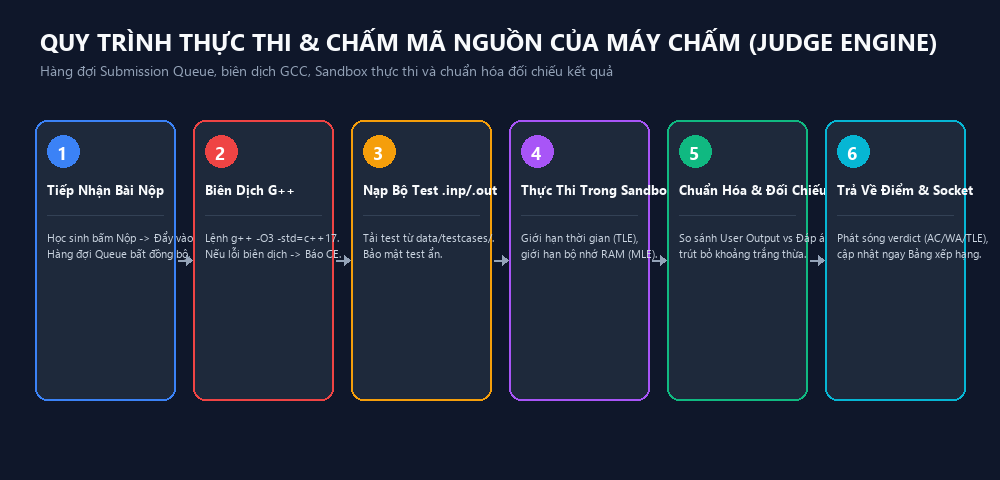

# HƯỚNG DẪN QUẢN TRỊ VIÊN & KỸ THUẬT VIÊN PHÒNG MÁY (ADMIN_GUIDE)

> **Phân hệ:** Quản trị máy chủ, Cấu hình mạng LAN & Bảo mật hệ thống  
> **Phiên bản:** ChauCaoJudge v1.6.0  
> **Dành cho:** Quản trị viên hệ thống, Kỹ thuật viên phòng máy Tin học

---

## 1. CÀI ĐẶT & KHỞI CHẠY MÁY CHỦ CHAUCAOJUDGE

Hệ thống ChauCaoJudge có thể được triển khai theo 3 hình thức tùy thuộc vào cơ sở hạ tầng của trường học:

### Cách 1: Chạy từ bộ cài đặt Desktop (Khuyến nghị cho trường phổ thông)
1. Tải và chạy tệp cài đặt `ChauCaoJudge_Setup_1.6.0.exe` trên máy tính giáo viên.
2. Ứng dụng sẽ tự động cài đặt vào `C:\Program Files\ChauCaoJudge` hoặc thư mục tùy chọn và tạo Shortcut trên Desktop.
3. Khi khởi động ứng dụng, máy chủ Node.js backend (cổng `4000`) và cổng phát sóng UDP discovery (`41234`) sẽ tự động chạy ngầm.

### Cách 2: Chạy trực tiếp từ mã nguồn / Chế độ Portable
1. Yêu cầu cài đặt **Node.js 18.x LTS trở lên** và bộ biên dịch **MinGW GCC/G++** trên máy chủ.
2. Mở cửa sổ dòng lệnh tại thư mục dự án và chạy:
   ```bash
   npm run start
   ```
   Hoặc chạy file batch tiện ích:
   ```cmd
   start-schooljudge.bat
   ```
3. Máy chủ sẽ khởi động tại địa chỉ: `http://localhost:4000`.

### Cách 3: Chạy bằng Docker Container (Phù hợp máy chủ Linux trường học)
1. Dự án đã có sẵn `Dockerfile` và `docker-compose.yml`.
2. Khởi chạy với lệnh:
   ```bash
   docker-compose up -d
   ```
3. Toàn bộ môi trường máy chấm và CSDL sẽ được cách ly an toàn trong container.

---

## 2. CẤU HÌNH MẠNG NỘI BỘ (LAN) & TƯỜNG LỬA (FIREWALL)

Để toàn bộ phòng máy học sinh (30-50 máy trạm) có thể kết nối thông suốt với máy chủ:

### 2.1. Thiết lập IP Tĩnh cho Máy chủ
1. Mở **Network Connections** trên Windows (`ncpa.cpl`).
2. Nhấp chuột phải vào card mạng LAN (Ethernet) -> Chọn **Properties** -> **Internet Protocol Version 4 (TCP/IPv4)**.
3. Đặt IP tĩnh cho máy chủ (Ví dụ: `192.168.1.100`, Subnet mask: `255.255.255.0`, Gateway: `192.168.1.1`).

### 2.2. Mở Cổng Tường Lửa Windows Firewall
Máy chủ ChauCaoJudge sử dụng 2 cổng mạng chính:
- **Port 4000 (TCP):** Giao tiếp REST API, truyền tải file bài nộp và kết nối Socket.IO thời gian thực.
- **Port 41234 (UDP):** Dịch vụ phát sóng dò tìm máy chủ tự động (LAN Auto-Discovery).

**Thao tác cấu hình tự động bằng PowerShell:**
Mở PowerShell bằng quyền Quản trị viên (Run as Administrator) tại thư mục dự án và chạy lệnh:
```powershell
powershell -ExecutionPolicy Bypass -File .\setup-firewall.ps1
```
Script sẽ tự động thêm 2 quy tắc Inbound Rules vào Windows Defender Firewall cho phép các máy trạm kết nối an toàn.

---

## 3. CẤU HÌNH TRÌNH BIÊN DỊCH C++ & SANDBOX MÁY CHẤM


*Hình 3: Quy trình biên dịch và kiểm soát tài nguyên của Judge Engine.*

1. Đăng nhập tài khoản Giáo viên/Quản trị viên (`admin`).
2. Trên thanh điều hướng bên trái, chọn **Cấu Hình Máy Chấm (Sandbox)** (`/teacher/settings`).
3. Các thông số quan trọng cần kiểm tra:
   - **Đường dẫn Trình biên dịch (Compiler Path):** Mặc định là `g++`. Nếu MinGW được cài ở thư mục riêng, nhập đường dẫn tuyệt đối (Ví dụ: `C:\MinGW\bin\g++.exe`). Bấm **"Kiểm tra G++"** để xem phiên bản GCC thực tế.
   - **Chế độ Docker Sandbox (Use Docker):** Bật `ON` nếu máy chủ có cài đặt Docker Daemon để cách ly mã nguồn tuyệt đối. Trên Windows phòng máy thông thường, để `OFF` để sử dụng MinGW sandbox native cực nhanh.
   - **Đóng băng Bảng điểm (Freeze Scoreboard):** Cho phép đóng băng bảng điểm công khai trong những phút cuối của kỳ thi để tạo kịch tính.
   - **Cho phép Chạy thử tự do (Allow Custom Run):** Cho phép học sinh chạy thử code với test tự nhập trước khi nộp.

---

## 4. QUẢN TRỊ CƠ SỞ DỮ LIỆU, SAO LƯU & PHỤC HỒI

### 4.1. Cấu trúc lưu trữ dữ liệu
- **Dữ liệu hệ thống chính:** Lưu trữ trong tệp `schooljudge_data.json`. Tệp này chứa toàn bộ danh sách người dùng, lớp học, kỳ thi, bài tập và điểm số.
- **Bộ Test bài tập:** Toàn bộ test case input/output được lưu trữ độc lập tại thư mục `data/testcases/<problemId>/` nhằm tối ưu tốc độ đọc ghi của CSDL chính.
- **Bài nộp & Tệp đính kèm:** Lưu tại thư mục `uploads/`.

### 4.2. Quy trình Sao lưu dữ liệu (Backup)
Trước mỗi kỳ thi lớn hoặc cuối học kỳ, kỹ thuật viên chỉ cần sao chép các thư mục sau vào ổ cứng dự phòng:
1. Tệp `schooljudge_data.json`
2. Thư mục `data/testcases/`
3. Thư mục `uploads/`

### 4.3. Phục hồi dữ liệu (Restore)
Khi chuyển máy chủ mới hoặc cài đặt lại hệ điều hành:
1. Cài đặt lại ứng dụng ChauCaoJudge.
2. Dừng ứng dụng.
3. Chép đè tệp `schooljudge_data.json` và thư mục `data/testcases/` đã sao lưu vào thư mục ứng dụng.
4. Khởi động lại ChauCaoJudge, toàn bộ dữ liệu kỳ thi và điểm số sẽ được khôi phục nguyên vẹn.

---

## 5. BẢO MẬT PHÒNG THI & KIỂM SOÁT ĐỊA CHỈ IP (IP WHITELIST)

Để tránh trường hợp học sinh bên ngoài phòng máy (kết nối qua Wi-Fi phụ hoặc làm bài hộ từ xa), ChauCaoJudge cung cấp cơ chế **IP Whitelist** mạnh mẽ:
1. Khi giáo viên tạo/sửa kỳ thi tại **Kỳ Thi & Ca Thi** (`/teacher/contests`), tìm đến mục **Bảo mật & Giới hạn IP**.
2. Nhập dải IP được phép tham gia thi:
   - Dải mạng phòng máy: `192.168.1.*`
   - Dải IP cụ thể: `192.168.1.1-192.168.1.50`
   - Danh sách IP ngăn cách bởi dấu phẩy: `192.168.1.10, 192.168.1.11, 192.168.1.12`
3. Khi học sinh đăng nhập từ một địa chỉ IP nằm ngoài danh sách, hệ thống sẽ tự động chặn và hiển thị thông báo: *"Địa chỉ IP của bạn không được phép tham gia kỳ thi này"*.

---

## 6. KHẮC PHỤC SỰ CỐ DÀNH CHO KỸ THUẬT VIÊN (TROUBLESHOOTING)

### Sự cố 1: Lỗi cổng 4000 bị chiếm dụng (Port 4000 already in use)
**Nguyên nhân:** Phiên bản cũ của server đang chạy ngầm hoặc có ứng dụng khác chiếm cổng 4000.  
**Cách xử lý:**
Mở PowerShell và chạy lệnh tìm tiến trình đang giữ cổng:
```powershell
netstat -ano | findstr :4000
```
Sau đó tắt tiến trình đó bằng Task Manager hoặc lệnh:
```powershell
taskkill /F /PID <PID_tìm_thấy>
```

### Sự cố 2: Học sinh không tìm thấy máy chủ qua UDP Discovery
**Nguyên nhân:** Switch mạng trong phòng máy đang bật tính năng chặn gói tin Broadcast/Multicast (IGMP Snooping hoặc Client Isolation).  
**Cách xử lý:**
1. Hướng dẫn học sinh bấm vào mục **"Nhập IP thủ công"** trên cửa sổ LAN Discovery.
2. Nhập trực tiếp địa chỉ IP máy chủ giáo viên (ví dụ: `http://192.168.1.100:4000`).
3. Kiểm tra cấu hình Switch nếu muốn bật lại tính năng Broadcast.

### Sự cố 3: Máy chấm báo lỗi "g++: command not found"
**Nguyên nhân:** Biến môi trường PATH trên máy chủ chưa trỏ đến thư mục `bin` của MinGW.  
**Cách xử lý:**
1. Thêm `C:\MinGW\bin` (hoặc đường dẫn chứa `g++.exe`) vào System PATH.
2. Hoặc dán trực tiếp đường dẫn file `g++.exe` vào ô cấu hình trong menu **Cấu Hình Máy Chấm (Sandbox)** của ChauCaoJudge.
