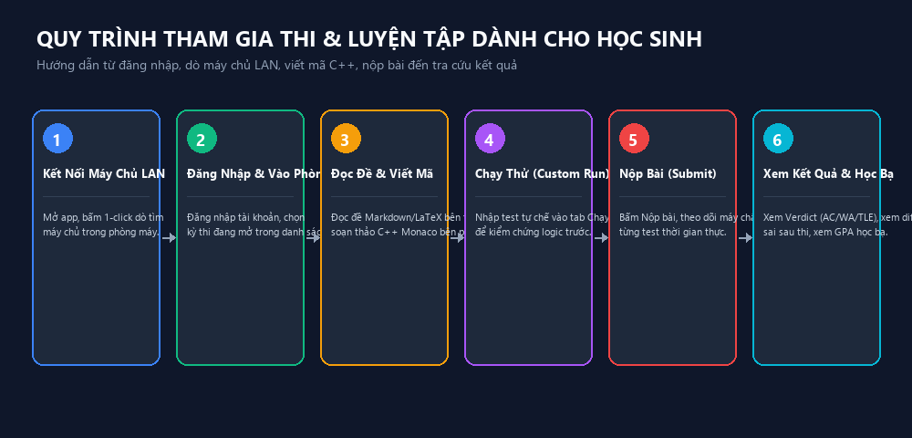
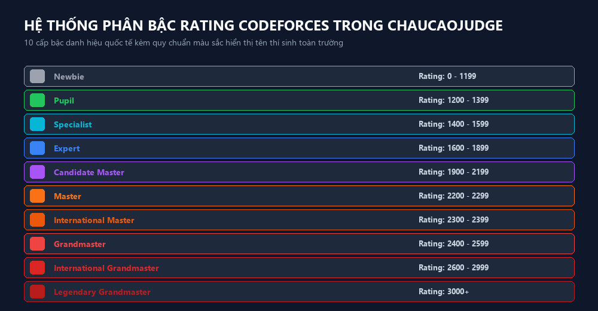

# HƯỚNG DẪN DÀNH CHO HỌC SINH — CHAUCAOJUDGE (v1.6.0)
*Cẩm nang tham gia kỳ thi, luyện lập trình thi đấu và chinh phục bảng xếp hạng*

---

## MỤC LỤC

1. [Giới thiệu & Khởi động nhanh](#1-giới-thiệu--khởi-động-nhanh)
2. [Đăng nhập & Kết nối phòng thi LAN](#2-đăng-nhập--kết-nối-phòng-thi-lan)
3. [Giao diện phòng thi & Trình soạn thảo Monaco](#3-giao-diện-phòng-thi--trình-soạn-thảo-monaco)
4. [Quy trình làm bài: Soạn thảo, Chạy thử & Nộp bài](#4-quy-trình-làm-bài-soạn-thảo-chạy-thử--nộp-bài)
5. [Giải mã thông báo máy chấm & So sánh lỗi (Diff WA)](#5-giải-mã-thông-báo-máy-chấm--so-sánh-lỗi-diff-wa)
6. [Hệ thống Rating 10 bậc Codeforces & Bảng phong thần](#6-hệ-thống-rating-10-bậc-codeforces--bảng-phong-thần)
7. [Học bạ điện tử & Biểu đồ tiến độ học tập](#7-học-bạ-điện-tử--biểu-đồ-tiến-độ-học-tập)
8. [Đấu trường 1v1 Arena & Luyện tập với Bot](#8-đấu-trường-1v1-arena--luyện-tập-với-bot)
9. [100 Danh hiệu Thành tựu & Cửa hàng Đổi quà](#9-100-danh-hiệu-thành-tựu--cửa-hàng-đổi-quà)
10. [Các lỗi thường gặp & Bí kíp tối ưu hóa code](#10-các-lỗi-thường-gặp--bí-kíp-tối-ưu-hóa-code)

---

## 1. GIỚI THIỆU & KHỞI ĐỘNG NHANH

Chào mừng bạn đến với **ChauCaoJudge** — nền tảng chấm bài tự động và thi đấu lập trình thế hệ mới! Với ChauCaoJudge, bạn không chỉ được chấm bài tức thì trong vài phần trăm giây mà còn được trải nghiệm hệ thống xếp hạng chuẩn thể thức quốc tế Codeforces, mở khóa thành tựu và đổi lấy những phần quà thiết thực ngay tại lớp học.


*Hình 4.1: Quy trình 5 bước chinh phục một bài toán trên ChauCaoJudge*

---

## 2. ĐĂNG NHẬP & KẾT NỐI PHÒNG THI LAN

### 2.1. Tự động tìm máy chủ qua mạng LAN (1-Click Discovery)
Khi bước vào phòng máy vi tính của trường:
1. Mở ứng dụng **ChauCaoJudge** từ màn hình Desktop.
2. Tại màn hình Kết nối: Ứng dụng sẽ tự động phát hiện máy chủ của giáo viên trong cùng mạng nội bộ (nhờ giao thức UDP Broadcast).
3. Nhấp chọn tên máy chủ hiển thị trên danh sách (ví dụ: `SERVER_GV_TIN - 192.168.1.100:4000`) và bấm **Kết nối**.
4. *Nếu không tự nhận:* Nhập trực tiếp địa chỉ IP do giáo viên cung cấp vào ô **Địa chỉ máy chủ** (Ví dụ: `192.168.1.100:4000`) và nhấn **Thử kết nối**.

### 2.2. Đăng nhập tài khoản
* **Tên đăng nhập (Mã định danh):** Thường là mã học sinh do giáo viên cấp (Ví dụ: `HS060101` hoặc `nguyen_van_a`).
* **Mật khẩu:** Nhập mật khẩu được cấp (lần đầu nên đổi sang mật khẩu dễ nhớ của riêng bạn).
* Nhấn **Đăng nhập**. Giao diện chính sẽ hiển thị danh sách các kỳ thi đang diễn ra dành cho lớp của bạn.

---

## 3. GIAO DIỆN PHÒNG THI & TRÌNH SOẠN THẢO MONACO

Khi bước vào phòng thi, màn hình được bố trí khoa học dạng chia đôi (Split-Pane), giúp bạn vừa đọc đề vừa viết code mà không phải chuyển qua lại giữa các cửa sổ:

```text
┌──────────────────────────────────────┬──────────────────────────────────────┐
│ CỘT TRÁI: ĐỀ BÀI (STATEMENT VIEWER)   │ CỘT PHẢI: TRÌNH SOẠN THẢO (MONACO)   │
├──────────────────────────────────────┼──────────────────────────────────────┤
│ • Tên bài, Giới hạn TG (s), RAM (MB)  │ • Thanh chọn Ngôn ngữ (C++, Py, Pas) │
│ • Nội dung mô tả bài toán            │ • Khu vực viết mã (Syntax Highlight) │
│ • Định dạng Dữ liệu vào / Dữ liệu ra │ • Cụm phím tắt tiện ích              │
│ • Bảng Ví dụ mẫu (Sample Input/Output)│ • Khung Chạy thử (Custom Input/Out)  │
│ • Nút Copy Input mẫu chỉ với 1 click │ • Nút NỘP BÀI (Xanh lá nổi bật)      │
└──────────────────────────────────────┴──────────────────────────────────────┘
                   ◄─── Thanh kéo co giãn tỉ lệ màn hình ───►
```

### Các tiện ích nổi bật của Trình soạn thảo Monaco:
* **Gợi ý code thông minh (IntelliSense):** Tự động hoàn thành từ khóa lệnh, hàm có sẵn, tên biến.
* **Tô màu cú pháp đa ngôn ngữ:** Hỗ trợ C++17, C++20, Python 3, Pascal, Java.
* **Tùy chỉnh linh hoạt:** Thay đổi kích thước chữ (Font size), giao diện Sáng (Light) hoặc Tối (Dark mode).
* **Phím tắt hữu ích:**
  * `Ctrl + Space`: Bật gợi ý code.
  * `Ctrl + /`: Bật/tắt ghi chú (Comment) nhanh một hoặc nhiều dòng.
  * `Ctrl + F`: Tìm kiếm từ khóa trong bài.
  * `Ctrl + H`: Tìm và thay thế biến/từ khóa.
  * `F11`: Bật chế độ Toàn màn hình (Full-screen focus).

---

## 4. QUY TRÌNH LÀM BÀI: SOẠN THẢO, CHẠY THỬ & NỘP BÀI

### Bước 1: Phân tích đề bài & Đọc kỹ ràng buộc
* Chú ý kỹ **Giới hạn thời gian (Time Limit)** và **Giới hạn bộ nhớ (Memory Limit)** ở đầu trang.
* Xem cỡ dữ liệu $N$:
  * Nếu $N \le 10^5$: Cần thuật toán $O(N \log N)$ hoặc $O(N)$.
  * Nếu $N \le 10^3$: Có thể dùng thuật toán $O(N^2)$.
  * Nếu $N \le 20$: Có thể dùng thuật toán quay lui/duyệt nhánh cận $O(2^N)$.

### Bước 2: Soạn thảo mã nguồn
Chọn đúng ngôn ngữ bạn sử dụng trên thanh công cụ (ví dụ: `C++ (G++ 17)`). Hãy tổ chức code rõ ràng, nhập xuất dữ liệu chuẩn qua luồng chuẩn (`cin/cout` trong C++, `input()/print()` trong Python).

> [!TIP]
> Trong C++, thêm 2 dòng sau vào đầu hàm `main()` để tăng tốc độ nhập xuất vượt trội:
> ```cpp
> ios_base::sync_with_stdio(false);
> cin.tie(NULL);
> ```

### Bước 3: Chạy thử với dữ liệu mẫu (Custom Run)
* ChauCaoJudge cho phép bạn chạy thử bài trực tiếp trên máy chấm mà **không bị tính lượt nộp**:
  1. Bật khung **Chạy thử (Run with custom input)**.
  2. Dán dữ liệu thử nghiệm vào ô Input (có thể bấm nút *Copy Input mẫu* ở đề bài).
  3. Nhấn nút **Chạy thử** (hoặc dùng tổ hợp phím tắt nhanh).
  4. Hệ thống sẽ trả về **Dữ liệu ra (Output)** thực tế cùng thời gian chạy (Execution Time tính bằng mili-giây) và bộ nhớ tiêu thụ.
  5. So sánh với kết quả mong đợi trước khi quyết định nộp chính thức.

### Bước 4: Nộp bài chính thức (Submit Solution)
1. Khi đã chắc chắn với thuật toán, nhấn nút **NỘP BÀI** (màu xanh lá ở góc trên bên phải).
2. Hệ thống sẽ khóa nút trong chốc lát và chuyển sang trạng thái: `Đang gửi...` $\rightarrow$ `Đang chờ chấm (Queued)...` $\rightarrow$ `Đang chạy trên Sandbox...`.
3. Chỉ sau vài giây, kết quả phán quyết sẽ hiện ra kèm số điểm và chi tiết từng test con.

---

## 5. GIẢI MÃ THÔNG BÁO MÁY CHẤM & SO SÁNH LỖI (DIFF WA)

### 5.1. Bảng ý nghĩa các mã phán quyết
| Ký hiệu | Tên đầy đủ | Ý nghĩa & Nguyên nhân thường gặp |
| :---: | :--- | :--- |
| **AC** | **Accepted** | **Chính xác hoàn toàn!** Kết quả của bạn trùng khớp 100% với đáp án chuẩn. |
| **WA** | **Wrong Answer** | **Sai kết quả.** Chương trình chạy xong nhưng in ra kết quả khác với đáp án (hoặc sai định dạng in hoa/thường, khoảng trắng, xuống dòng). |
| **TLE** | **Time Limit Exceeded** | **Quá giới hạn thời gian.** Thuật toán quá chậm hoặc bị lặp vô tận (`while(true)` không có điểm dừng). |
| **MLE** | **Memory Limit Exceeded** | **Quá giới hạn bộ nhớ.** Khai báo mảng quá lớn vượt mức cấu hình cho phép của bài toán. |
| **RTE / RE**| **Runtime Error** | **Lỗi thực thi.** Tràn mảng (truy cập phần tử ngoài chỉ số mảng), chia cho số 0, hoặc đệ quy quá sâu gây tràn ngăn xếp (Stack Overflow). |
| **CE** | **Compilation Error** | **Lỗi biên dịch.** Code bị sai cú pháp, thiếu dấu chấm phẩy, thiếu thư viện. Nhấp vào để xem chi tiết log lỗi của trình biên dịch. |

### 5.2. Tính năng độc quyền: Xem đối sánh lỗi trực quan (Diff WA)
* Trong quá trình kỳ thi đang diễn ra, vì tính bảo mật và công bằng, hệ thống sẽ ẩn dữ liệu test để tránh trường hợp học sinh "hardcode" (in kết quả tương ứng với từng test).
* **Sau khi kỳ thi kết thúc (hoặc ở chế độ Luyện tập tự do):**
  * Bạn có quyền nhấp vào bài nộp bị `WA` để mở trình xem đối sánh **Side-by-Side Diff**.
  * Cột bên trái hiển thị **Kết quả chuẩn (Expected Output)** của giáo viên.
  * Cột bên phải hiển thị **Kết quả thực tế (Your Output)** của bạn.
  * Các ký tự, dòng chữ sai khác sẽ được tô màu đỏ/xanh nổi bật, giúp bạn nhận ra ngay lập tức mình đã thiếu khoảng trắng, quên xuống dòng hay tính sai tại ca kiểm thử đặc biệt nào!

---

## 6. HỆ THỐNG RATING 10 BẬC CODEFORCES & LEADERBOARD

ChauCaoJudge áp dụng thuật toán tính Rating dựa trên mô hình kỳ vọng thứ hạng tương tự Codeforces và AtCoder.


*Hình 6.1: Thang bậc Rating 10 cấp độ và màu sắc đại diện*

### 6.1. Bảng 10 cấp bậc Rating & Màu sắc tài khoản
Khi đạt tới mốc Rating tương ứng, tên tài khoản trên Leaderboard, phòng thi và danh sách học sinh sẽ hiển thị theo màu sắc đại diện:

| Cấp bậc | Rank (Tiếng Anh) | Mức Rating | Màu sắc đại diện |
| :---: | :--- | :---: | :---: |
| **1** | **Newbie** | $0 - 1199$ | Xám (Gray) |
| **2** | **Pupil** | $1200 - 1399$ | Xanh lục (Green) |
| **3** | **Specialist** | $1400 - 1599$ | Lục lam (Cyan) |
| **4** | **Expert** | $1600 - 1899$ | Xanh dương (Blue) |
| **5** | **Candidate Master**| $1900 - 2199$ | Tím (Violet) |
| **6** | **Master** | $2200 - 2299$ | Cam (Orange) |
| **7** | **International Master**| $2300 - 2399$ | Cam đậm (Bright Orange) |
| **8** | **Grandmaster** | $2400 - 2599$ | Đỏ (Red) |
| **9** | **International Grandmaster**| $2600 - 2999$ | Đỏ đậm (Dark Red) |
| **10**| **Legendary Grandmaster**| $\ge 3000$ | Đỏ viền đen (Red with black initial) |

### 6.2. Cơ chế điều chỉnh Rating sau Contest
* **Thứ hạng thực tế so với Thứ hạng kỳ vọng:** Trước contest, hệ thống tính thứ hạng kỳ vọng của học sinh dựa trên Rating hiện tại so với các thí sinh cùng tham gia.
* Thứ hạng thực tế cao hơn thứ hạng kỳ vọng: **Rating tăng (+Delta)**.
* Thứ hạng thực tế thấp hơn thứ hạng kỳ vọng: **Rating giảm (-Delta)**.
* Rating chỉ được cập nhật sau các Contest chính thức có kích hoạt tính năng Rating.

---

## 7. HỌC BẠ ĐIỆN TỬ & BIỂU ĐỒ TIẾN ĐỘ HỌC TẬP

Để theo dõi sự trưởng thành của bản thân qua từng tuần học, hãy truy cập vào mục **Học bạ của tôi (My Transcript)**:

* **Biểu đồ biến thiên Rating:** Đường biểu diễn trực quan phản ánh phong độ leo rank của bạn qua tất cả các kỳ thi chính thức đã tham gia.
* **Thống kê điểm trung bình GPA:** Phản ánh tỉ lệ hoàn thành nhiệm vụ và số điểm tích lũy trong kỳ.
* **Biểu đồ Radar kỹ năng:** Phân tích thế mạnh và điểm cần cải thiện của bạn trên các mảng thuật toán:
  * *Xử lý mảng & Chuỗi (String Manipulation)*
  * *Tìm kiếm & Sắp xếp (Sorting & Searching)*
  * *Quy hoạch động (Dynamic Programming)*
  * *Đồ thị & Cây (Graph Theory)*
  * *Số học & Hình học (Number Theory)*

---

## 8. ĐẤU TRƯỜNG 1v1 ARENA & LUYỆN TẬP VỚI BOT

Bạn muốn rèn luyện phản xạ lập trình tốc độ cao trong giờ giải lao? Hãy bước vào **Đấu trường 1v1 Arena**!

### 8.1. Đấu tay đôi với Bạn cùng lớp (Live 1v1)
* Nhấn **Tạo phòng đấu** và gửi mã phòng cho bạn bè (hoặc bấm **Tìm trận nhanh**).
* Khi cả 2 đã sẵn sàng, hệ thống sẽ chọn ngẫu nhiên một bài toán có độ khó phù hợp.
* Đồng hồ đếm ngược bắt đầu! Ai nộp bài đạt `AC` nhanh hơn và tốn ít lượt nộp sai hơn sẽ giành chiến thắng tuyệt đối.

### 8.2. Khiêu chiến với Bot AI
* Khi không có bạn cùng chơi trực tuyến, bạn có thể lựa chọn đấu luyện với Bot:
  * **Bot Nhập môn (Easy):** Phản xạ chậm, phù hợp cho người mới bắt đầu làm quen.
  * **Bot Tiêu chuẩn (Medium):** Thuật toán vững vàng, tốc độ giải trung bình 10-15 phút.
  * **Bot Bậc thầy (Hard):** Tốc độ giải cực nhanh, độ chính xác gần như hoàn hảo — thử thách đích thực cho các cao thủ đội tuyển HSG!

---

## 9. 100 DANH HIỆU THÀNH TỰU & CỬA HÀNG ĐỔI QUÀ

ChauCaoJudge không chỉ có điểm thi lý thuyết mà còn mang lại những phần thưởng hữu hình và niềm vui học tập:

### 9.1. Mở khóa Thành tựu (Achievements)
Hệ thống có hơn 100 thành tựu đa dạng với 4 cấp độ huy hiệu (Đồng, Bạc, Vàng, Kim Cương):
* **Bắt đầu hành trình:** Nộp bài thi đầu tiên thành công.
* **Bách phát bách trúng:** Đạt `AC` ngay ở lần nộp đầu tiên trong kỳ thi.
* **Cú đêm bền bỉ:** Luyện tập giải hơn 20 bài trong chế độ Tự luyện.
* **Thần tốc:** Đạt `AC` một bài toán trong vòng dưới 3 phút kể từ khi mở đề.
* **Chinh phục đỉnh cao:** Thăng hạng lên mức *Master* hoặc *Grandmaster*.

### 9.2. Tích lũy Điểm thưởng & Đổi quà thực tế (Reward Store)
* Mỗi khi mở khóa một thành tựu, bạn sẽ nhận được **Điểm thưởng (Reward Points)** tương ứng (Lưu ý: Điểm thưởng hoàn toàn độc lập với Điểm thi và Rating).
* Truy cập mục **Cửa hàng Quà tặng (Shop)** để đổi điểm lấy các vật phẩm do thầy cô chuẩn bị:
  * 📘 Sách tham khảo Lập trình nâng cao
  * 🖋️ Bút viết cao cấp, Vở ghi chép Tin học
  * 🏷️ Huy hiệu (Sticker/Badge) độc quyền ChauCaoJudge
  * 🎫 Phiếu miễn bài tập về nhà / Cộng điểm kiểm tra thường xuyên
* Khi nhấn **Đổi quà**, hệ thống sẽ ghi nhận yêu cầu vào danh sách chờ. Thầy cô sẽ phê duyệt và trao quà tận tay cho bạn trong tiết học kế tiếp!

---

## 10. CÁC LỖI THƯỜNG GẶP & BÍ KÍP TỐI ƯU HÓA CODE

### 10.1. Bí kíp tránh lỗi `WA` (Wrong Answer)
1. **Đọc kỹ từng chữ của đề:** Đề bài yêu cầu in ra `"YES"` hay `"Yes"`, `"NO"` hay `"no"`? Sai chữ hoa/thường máy chấm sẽ tính là `WA`.
2. **Kiểm tra trường hợp biên (Corner Cases):**
   * Số âm, số $0$, số nguyên cực đại ($2 \times 10^9$ cần dùng kiểu `long long` trong C++).
   * Mảng rỗng hoặc chỉ có 1 phần tử.
   * Dữ liệu có thể chứa ký tự khoảng trắng hoặc dòng trống hay không?

### 10.2. Bí kíp tránh lỗi `TLE` (Time Limit Exceeded)
1. **Tránh dùng các thao tác chậm trong vòng lặp:**
   * Không dùng `endl` trong C++ khi lặp nhiều lần (hãy thay bằng `'\n'`).
   * Hạn chế gọi hàm tính độ dài chuỗi `s.length()` lặp đi lặp lại trong điều kiện vòng `for`.
2. **Lựa chọn cấu trúc dữ liệu hợp lý:**
   * Dùng `std::unordered_map` thay cho `std::map` nếu chỉ cần tra cứu thông thường.
   * Dùng mảng cộng dồn (Prefix Sum) thay vì duyệt tính tổng lặp lại.

### 10.3. Bí kíp tránh lỗi `RTE` (Runtime Error)
* Khai báo kích thước mảng dư ít nhất 5 đến 10 phần tử so với giới hạn đề bài để tránh lỗi truy cập ngoài chỉ số `A[N]`.
* Trong C++, nên khai báo các mảng tĩnh kích thước lớn ở ngoài hàm `main` (biến toàn cục) để tránh bị tràn bộ nhớ ngăn xếp (Stack).

---
*Chúc các bạn học sinh có những giờ học bổ ích, làm chủ tư duy thuật toán và gặt hái thật nhiều thành tích rực rỡ cùng ChauCaoJudge!*
