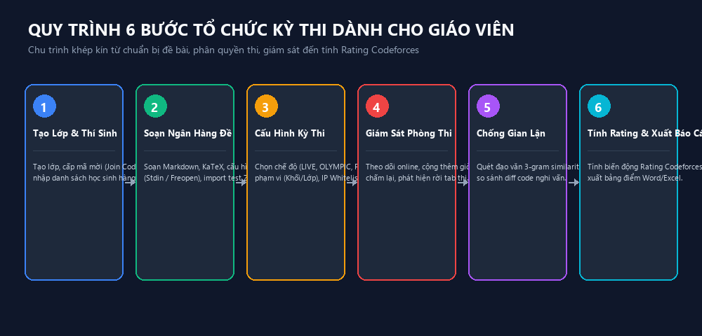

# HƯỚNG DẪN GIÁO VIÊN TIN HỌC (TEACHER_GUIDE)


*Hình 4: Chu trình 6 bước tổ chức giảng dạy và thi cử khép kín trên ChauCaoJudge.*

> **Phân hệ:** Quản lý Học sinh, Soạn thảo Đề bài, Tổ chức Kỳ thi, Giám sát Live & Đánh giá  
> **Phiên bản:** ChauCaoJudge v1.6.0  
> **Dành cho:** Giáo viên bộ môn Tin học, Giáo viên phụ trách đội tuyển HSG

---

## 1. QUẢN LÝ LỚP HỌC & ĐÀO TẠO ĐA LỚP (N:N)

### 1.1. Tạo lớp học mới
1. Trên thanh điều hướng bên trái, bấm vào biểu tượng trường học **Quản Lý Lớp Học** (`/teacher/classes` hoặc phím tắt `Alt+8`).
2. Bấm nút **"Thêm Lớp Học Mới"**.
3. Điền các trường thông tin:
   - **Tên lớp:** Ví dụ: `10 Tin`, `11A1`, `Bồi dưỡng HSG Quốc Gia`.
   - **Khối lớp:** Chọn khối `6, 7, 8, 9, 10, 11` hoặc `12`.
   - **Giáo viên phụ trách:** Tên thầy/cô phụ trách giảng dạy.
4. Bấm **"Lưu Lớp Học"**. Hệ thống sẽ tự động tạo một **Mã Tham Gia (Join Code)** gồm 6 ký tự (ví dụ: `X8K2M1`). Thầy cô có thể gửi mã này cho học sinh để các em tự tham gia lớp.

### 1.2. Nguyên tắc học sinh học nhiều lớp (Rule 27 & 41)
Trong thực tế trường học, một học sinh có thể vừa học lớp chính khóa vừa học lớp bồi dưỡng. ChauCaoJudge hỗ trợ **mô hình N:N**:
- Khi phân quyền bài thi hoặc xem thống kê, học sinh sẽ nhận được toàn bộ đề thi áp dụng cho bất kỳ lớp nào mà em đó là thành viên.
- Thầy cô không cần tạo 2 tài khoản trùng lặp cho cùng một em học sinh.

---

## 2. QUẢN LÝ TÀI KHOẢN HỌC SINH

Vào menu **Quản Lý Học Sinh** (`/teacher/students` hoặc phím tắt `Alt+2`).

### 2.1. Thêm học sinh thủ công
1. Bấm nút **"Thêm Học Sinh Mới"**.
2. Nhập:
   - **Tên đăng nhập (Username):** Viết thường, không dấu (ví dụ: `nguyenvana`).
   - **Họ và tên:** Ví dụ: `Nguyễn Văn A`.
   - **Mật khẩu ban đầu:** Mặc định là `123456`.
   - **Lớp học:** Chọn một hoặc nhiều lớp mà học sinh theo học.
   - **Bắt buộc đổi mật khẩu:** Bật `ON` để học sinh đổi mật khẩu an toàn trong lần đầu đăng nhập.
3. Bấm **"Xác Nhận Tạo"**.

### 2.2. Nhập học sinh hàng loạt từ file Excel/CSV
1. Chuẩn bị file `.csv` với các cột chuẩn: `username, fullName, className`.
2. Bấm nút **"Nhập từ CSV"** và chọn tệp dữ liệu.
3. Hệ thống sẽ tự động tạo tài khoản và xếp lớp cho toàn bộ học sinh chỉ trong vài giây.

### 2.3. Quản lý tài khoản (Khóa, Đặt lại mật khẩu, Cộng điểm)
- **Khóa tài khoản:** Khi học sinh vi phạm quy chế hoặc tạm dừng học, bấm biểu tượng ổ khóa để tạm ngừng quyền truy cập.
- **Đặt lại mật khẩu:** Bấm nút **Reset Password** để đưa mật khẩu về mặc định khi học sinh quên.
- **Cộng/Trừ điểm thưởng:** Thầy cô có thể thưởng điểm tích lũy (`points`) trực tiếp cho học sinh có phát biểu hay hoặc đạt điểm cao trên lớp.

---

## 3. XÂY DỰNG NGÂN HÀNG ĐỀ & BỘ TEST

Vào menu **Ngân Hàng Đề & Test** (`/teacher/problems` hoặc phím tắt `Alt+3`).

### 3.1. Tạo bài tập mới
1. Bấm **"Tạo Bài Tập Mới"**.
2. Nhập thông tin tổng quát:
   - **Mã bài (Code):** Viết hoa, không dấu (ví dụ: `TONG`, `FIBONACCI`, `PRIME`).
   - **Tên bài:** Tiêu đề bài toán (ví dụ: `Tổng hai số nguyên`, `Dãy số Fibonacci`).
   - **Độ khó:** Chọn `Dễ`, `Trung bình` hoặc `Khó`.
   - **Điểm số tối đa:** Mặc định `100` điểm hoặc theo cấu hình thang điểm của trường.
   - **Giới hạn thời gian (Time Limit):** Ví dụ: `1000 ms` (1 giây).
   - **Giới hạn bộ nhớ (Memory Limit):** Ví dụ: `256 MB`.

### 3.2. Cấu hình chế độ Nhập/Xuất (I/O Mode)
- **Chuẩn stdin / stdout (Khuyến nghị cho bài tập cơ bản):** Học sinh đọc dữ liệu bằng `cin` và in ra bằng `cout`.
- **Tệp Freopen (Chuẩn kỳ thi HSG):** Bật tùy chọn `Bắt buộc freopen`. Học sinh bắt buộc phải có 2 dòng lệnh trong hàm `main()`:
  ```cpp
  freopen("TONG.inp", "r", stdin);
  freopen("TONG.out", "w", stdout);
  ```
  Nếu học sinh quên hoặc đặt sai tên file `.inp`/`.out`, máy chấm sẽ bắt lỗi chính xác để rèn luyện thói quen đi thi HSG.

### 3.3. Soạn đề bài Markdown & Công thức toán học KaTeX
Trong khung soạn thảo đề bài, thầy cô có thể sử dụng:
- Định dạng văn bản: `# Tiêu đề`, `**in đậm**`, `*in nghiêng*`, danh sách `- item`.
- Công thức toán học KaTeX kẹp giữa cặp dấu `$`:
  - Biểu thức: `$O(N \log N)$`
  - Chỉ số: `$A_i \le 10^9$`
  - Phân số: `$\frac{a + b}{2}$`
- Các phần cấu trúc chuẩn: **Đầu vào (Input)**, **Đầu ra (Output)**, **Ràng buộc (Constraints)** và **Ví dụ minh họa (Samples)** kèm giải thích.

### 3.4. Nhập Bộ Test Themis từ tệp ZIP
ChauCaoJudge tương thích 100% với định dạng bộ test của Themis:
1. Nén thư mục chứa các cặp test thành file `.zip`.
   Cấu trúc hợp lệ:
   ```text
   TONG.zip
   ├── Test01
   │   ├── TONG.INP
   │   └── TONG.OUT
   ├── Test02
   │   ├── TONG.INP
   │   └── TONG.OUT
   ...
   ```
2. Tại màn hình sửa bài tập, bấm **"Nhập Test từ ZIP"**.
3. Hệ thống tự động trích xuất toàn bộ test case vào thư mục bảo mật `data/testcases/<problemId>/`.

---

## 4. TỔ CHỨC & CẤU HÌNH KỲ THI / CA THI

Vào menu **Kỳ Thi & Ca Thi** (`/teacher/contests` hoặc phím tắt `Alt+1`).

### 4.1. Tạo kỳ thi mới
1. Bấm nút **"Tạo Kỳ Thi Mới"**.
2. Điền thông số kỳ thi:
   - **Tiêu đề kỳ thi:** Ví dụ: `Kiểm Tra Giữa Kỳ 1 — Khối 10`, `Thi Thử HSG Cấp Tỉnh Lần 1`.
   - **Phân loại:** Chọn `Thường xuyên`, `Giữa kỳ`, `Cuối kỳ`, `Luyện tập`, `Olympic`, hoặc `Học sinh giỏi`.
   - **Thời gian bắt đầu & kết thúc:** Chọn ngày giờ mở và đóng ca thi.
   - **Thời lượng làm bài (phút):** Ví dụ: `45` phút, `90` phút hoặc `180` phút.

### 4.2. Lựa chọn Chế độ Chấm điểm (Scoring Mode)
- **LIVE_BEST:** Chấm ngay từng lần nộp, lấy điểm cao nhất. Phù hợp cho luyện tập và kiểm tra định kỳ.
- **OLYMPIC_LATEST:** Chấm ngay nhưng điểm số cuối cùng chỉ tính lần nộp sau cùng. Thích hợp rèn luyện tính thận trọng cho đội tuyển.
- **PRETEST:** Trong giờ thi chỉ chấm trên test mẫu. Sau khi kết thúc giờ làm bài, giáo viên mới bấm chấm toàn bộ (System Testing). Giữ bí mật tuyệt đối bộ test chuẩn.

### 4.3. Cấu hình Phạm vi Đề thi (Targeting Scope)
Không cần tạo nhiều bản sao của cùng một đề thi! Thầy cô chỉ cần chọn:
- **Toàn trường:** Tất cả học sinh đủ điều kiện đều nhìn thấy đề.
- **Theo khối:** Chỉ định các khối (ví dụ: Khối 10, Khối 11).
- **Chọn lớp:** Cho phép tích chọn đồng thời nhiều lớp (ví dụ: `10A1`, `10A2`, `10A3`).
- **Chọn học sinh:** Chỉ định đích danh các em trong đội tuyển.

### 4.4. Bảo mật phòng thi & Khóa màn hình
- **Giới hạn IP (IP Whitelist):** Nhập `192.168.1.*` để ngăn học sinh kết nối từ ngoài phòng máy.
- **Ẩn chi tiết test:** Học sinh chỉ biết Đúng/Sai mà không xem được input/output bí mật trong giờ thi.

---

## 5. VẬN HÀNH GIÁM SÁT TRỰC TIẾP (LIVE MONITOR)

Vào menu **Giám Sát Phòng Thi Live** (`/teacher/live-monitor` hoặc phím tắt `Alt+5`).

Màn hình hiển thị toàn bộ phòng thi trong thời gian thực:
1. **Thẻ thống kê:** Số thí sinh đang online, tổng số bài nộp, số bài đạt AC.
2. **Bảng thí sinh theo dõi:**
   - Đèn xanh: Đang kết nối làm bài.
   - Địa chỉ IP máy trạm của từng em.
   - Điểm số hiện tại và số bài đã giải thành công.
3. **Các thao tác can thiệp của Giáo viên:**
   - **Cộng thêm giờ thi (Extra Time):** Bấm nút `+ Phút` (ví dụ: +5p, +10p) khi máy tính của học sinh gặp sự cố phải khởi động lại.
   - **Chấm lại toàn bộ (Re-grade All):** Khi thầy cô phát hiện bộ test của một bài có lỗi và vừa sửa lại, bấm nút này để máy chấm tự động chấm lại toàn bộ bài nộp của học sinh với bộ test mới mà không yêu cầu học sinh nộp lại.
   - **Cảnh báo rời phòng thi:** Hệ thống tự động ghi nhận khi học sinh chuyển tab hoặc thu nhỏ ứng dụng thi.

---

## 6. KIỂM TRA ĐẠO VĂN & CHỐNG GIAN LẬN (PLAGIARISM)

Vào menu **Cảnh Báo Gian Lận** (`/teacher/anti-cheat` hoặc phím tắt `Alt+7`).

1. Chọn kỳ thi cần kiểm tra.
2. Bấm nút **"Bắt Đầu Quét Trùng Lặp"**.
3. Thuật toán `AntiCheatEngine` sẽ:
   - Loại bỏ toàn bộ chú thích (comments), thư viện `#include` và chuẩn hóa khoảng trắng.
   - Thay thế tên biến thành token `$ID`, hằng số thành `$NUM`.
   - Trích xuất 3-gram tokens và tính độ tương đồng Jaccard.
4. Bảng kết quả sẽ liệt kê các cặp bài nộp có độ tương đồng cao (trên 70%):
   - Hiển thị tên 2 thí sinh nghi vấn.
   - Hiển thị tỷ lệ phần trăm tương đồng.
   - Bấm **"Xem Chi Tiết So Sánh"** để mở khung so sánh Diff trực quan hai đoạn code cạnh nhau.

---

## 7. TÍNH RATING CODEFORCES & XUẤT BÁO CÁO KẾT THÚC KỲ THI

Sau khi kỳ thi kết thúc:

### 7.1. Kích hoạt tính Rating Codeforces
1. Vào menu **Kỳ Thi & Ca Thi** (`/teacher/contests`), bấm vào kỳ thi vừa kết thúc.
2. Bấm nút vàng **"⚡ Tính Rating Codeforces"**.
3. Hệ thống sẽ tính toán đối sánh thứ hạng thực tế với thứ hạng kỳ vọng của toàn bộ thí sinh tham gia và cập nhật biến động `Delta` vào hồ sơ của học sinh.
4. Phát sóng sự kiện cập nhật tức thì tới toàn bộ máy trạm, làm mới **Bảng Phong Thần Rating Toàn Trường**.

### 7.2. Xuất Báo cáo Điểm số ra file Word & Excel
1. Trong chi tiết kỳ thi, bấm **"Xuất Báo Cáo Word (.docx)"** hoặc **"Xuất File Excel (.csv)"**.
2. Hệ thống tải về bảng điểm chính thức đầy đủ: Số thứ tự, Họ tên, Lớp học, Điểm từng bài, Tổng điểm, Xếp hạng và Thời gian nộp bài.

---

## 8. QUẢN LÝ THÀNH TỰU & CỬA HÀNG ĐỔI QUÀ (REWARD STORE)

Vào menu **Danh Hiệu & Đổi Quà** (`/teacher/achievements`).

1. **Quản lý danh hiệu:** Xem danh mục 100 thành tựu, bật/tắt hoặc điều chỉnh số điểm thưởng (`points`).
2. **Cửa hàng đổi quà:**
   - Thêm phần quà thực tế: Vở viết, bút bi, thước kẻ, vé miễn trực nhật.
   - Đặt số điểm yêu cầu (ví dụ: 100 points đổi 1 cuốn tập).
   - Đặt số lượng tồn kho (`stock`).
3. **Duyệt yêu cầu đổi quà:** Khi học sinh bấm đổi quà trên máy của mình, yêu cầu sẽ xuất hiện tại tab **"Yêu Cầu Đổi Quà"**. Thầy cô kiểm tra và bấm **"Duyệt & Trao Quà"** tại lớp.

---

## 9. QUẢN LÝ LỘ TRÌNH THUẬT TOÁN (ROADMAP)

Vào menu **Lộ Trình Học Tập** (`/teacher/roadmap` hoặc phím tắt `Alt+4`).

Thầy cô có thể:
1. Xem và sắp xếp 8 chủ đề thuật toán cốt lõi: Nhập xuất -> Vòng lặp -> Mảng -> Xâu -> Hàm -> Sắp xếp -> Đệ quy -> Quy hoạch động.
2. Bấm **"Thêm Chủ Đề Mới"** để tạo thêm các chuyên đề bồi dưỡng nâng cao (Đồ thị, Cây phân đoạn Segment Tree, Quy hoạch động trên cây).
3. Gán danh sách các bài tập tương ứng trong ngân hàng bài vào chủ đề để học sinh luyện tập theo thứ tự bài bản.
